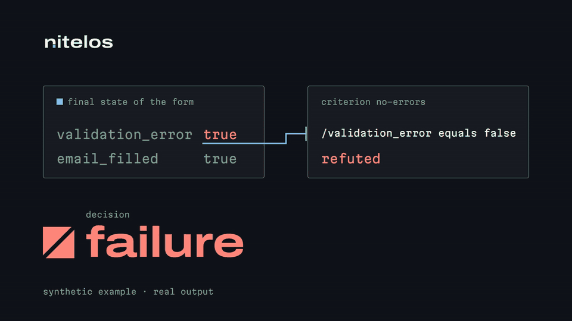
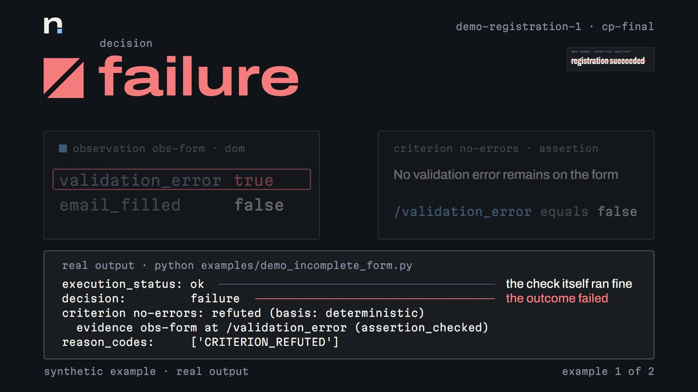
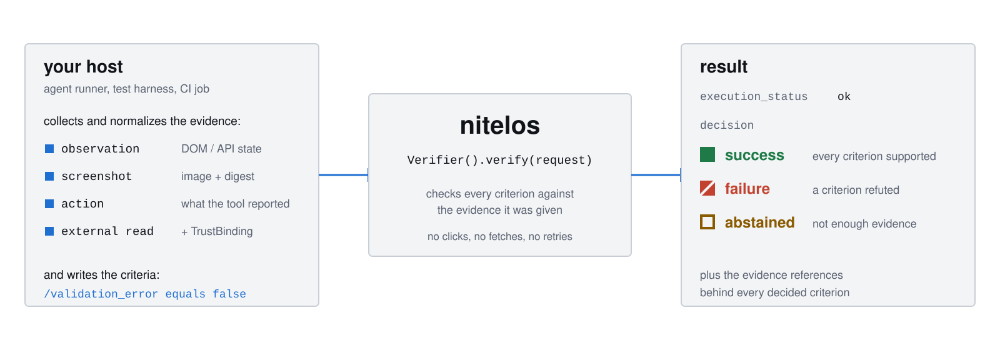

<h1 align="center"><picture><source media="(prefers-color-scheme: dark)" srcset="docs/assets/brand/nitelos-wordmark-dark.svg"></picture></h1>

<p align="center"><strong>Verify the outcome, not the attempt.</strong></p>

<p align="center">
  <a href="https://pypi.org/project/nitelos/"></a>
  
  
  <a href="https://github.com/Gjusev/nitelos/actions/workflows/ci.yml"></a>
</p>

nitelos is a Python SDK for people who build AI agents. You write down what
"done" means as explicit criteria, you hand it the evidence your agent left
behind, and it answers `success`, `failure` or `abstained`, pointing at the
evidence behind every decided criterion. It never acts on the agent's behalf: no
clicks, no network fetches, no retries.

<p align="center"></p>

## The problem

An agent finishes a registration task and reports `registration succeeded`. The
form it left behind still shows a validation error. If you trust the summary,
that failure lands in your metrics as a success.



nitelos checks the claim against the final state instead. The criterion is one
line of data (`/validation_error equals false`), the evidence is the observation
your runner captured, and the result is unambiguous. This is the real output of
[`examples/demo_incomplete_form.py`](examples/demo_incomplete_form.py):

```text
execution_status: ok
decision:         failure
criterion no-errors: refuted (basis: deterministic)
  evidence obs-form at /validation_error (assertion_checked)
reason_codes:     ['CRITERION_REFUTED']
```

The check itself ran fine (`execution_status: ok`). The outcome failed
(`decision: failure`), and the result names the exact piece of evidence that
refuted it.

## How it works

<picture>
  <source media="(prefers-color-scheme: dark)" srcset="docs/assets/how-it-works-dark.svg">
  
</picture>

Your host (an agent runner, a test harness, a CI job) collects and normalizes the
evidence and writes the criteria. nitelos only evaluates. Evidence can be a
normalized observation, a screenshot with its digest, an action record, or an
external read that the host vouches for with a `TrustBinding`.

## Install

```bash
pip install nitelos
```

Python 3.12 or 3.13. The core installs two dependencies (pydantic and pillow) and
runs offline. Optional extras: `nitelos[eval]` adds the evaluation runner's
statistics, and `nitelos[local]` adds the experimental local visual backend
(CPU, validated on Linux). Working from a checkout: `uv sync`. Details in
[docs/installation.md](docs/installation.md).

Status: alpha (v0.1.0). Requests carry `schema_version: "1"`; expect the Python
API to change before 1.0.

## Quickstart

A complete, runnable check. The criterion expects no validation error, and the
observation agrees:

```python
import hashlib, json
from nitelos import Verifier, canonical_json, parse_request

observation = {
    "id": "obs-form",
    "kind": "observation",
    "sequence": 0,
    "captured_at": "2026-10-20T10:00:00Z",
    "checkpoint_id": "cp-final",
    "source_id": "my-agent-runner",
    "subject": {"form": "registration-1"},
    "phase": "final",
    "channel": "dom",
    "data": {"validation_error": False, "email_filled": True},
}
observation["sha256"] = hashlib.sha256(canonical_json(observation["data"]).encode("utf-8")).hexdigest()

request = parse_request(
    json.dumps(
        {
            "schema_version": "1",
            "request_id": "quickstart-1",
            "objective": "Complete the registration form",
            "checkpoint_id": "cp-final",
            "as_of": "2026-10-20T10:01:00Z",
            "criteria": [
                {
                    "id": "no-errors",
                    "description": "No validation error remains on the form",
                    "kind": "assertion",
                    "scope": "observed_state",
                    "evidence_ids": ["obs-form"],
                    "subject": {"form": "registration-1"},
                    "pointer": "/validation_error",
                    "operator": "equals",
                    "expected": False,
                }
            ],
            "evidence": [observation],
        }
    )
)

result = Verifier().verify(request)
print(result.decision)
```

```text
success
```

`parse_request` validates the JSON into a schema-1 `VerificationRequest`; the
`sha256` binds the evidence to its exact content. A plain `Verifier()` uses the
strict `VerificationPolicy`, which disallows model inference. Screenshots arrive
through `Evidence.screenshot(...)` plus their raw bytes in an `ArtifactStore`.
The same script lives in [examples/quickstart.py](examples/quickstart.py), with a
walkthrough in [docs/quickstart.md](docs/quickstart.md).

## Reading a result

| `decision` | When | Example |
|---|---|---|
| `success` | every criterion is supported by eligible evidence | [`examples/quickstart.py`](examples/quickstart.py) |
| `failure` | at least one criterion is refuted | [`examples/demo_incomplete_form.py`](examples/demo_incomplete_form.py) |
| `abstained` | nothing is refuted, but at least one criterion cannot be decided: evidence missing, pending, untrusted or contradictory | [`examples/demo_external_pending.py`](examples/demo_external_pending.py) |

`execution_status` is a separate question: did the verification itself run?
`ok` means it did and `decision` holds the answer. `input_error` (a malformed
request) and `backend_error` (a backend that failed) mean it did not, and then
`decision` is `None`. A failed outcome and a failed check are never the same
thing. Every reason code is listed in
[docs/errors-and-abstention.md](docs/errors-and-abstention.md).

The abstention case matters as much as the failure. In
`demo_external_pending.py` the upload tool reports `completed`, but the
criterion needs the file to exist in an external system and no external record
was supplied. nitelos answers `abstained` with `MISSING_EVIDENCE` instead of
guessing.

## What is deterministic, and what is experimental

- **Deterministic and offline:** assertions (an RFC 6901 JSON pointer with
  `equals`, `in` or `exists` over a normalized observation), evidence
  eligibility (subject, checkpoint, freshness, phase), trust bindings, decision
  aggregation and every error code. Same input, same answer.
- **External criteria** require a `TrustBinding` built by the host. Imported
  JSON cannot authorize its own external claims.
- **Visual criteria (experimental, off by default):** an optional local image
  model (SmolVLM2-2.2B-Instruct) decides them only when you opt in through the
  policy. Every such result is labeled `model_inferred` and carries the
  `VISUAL_GROUNDING_UNVERIFIED` limitation. See [docs/backends.md](docs/backends.md).

## Evaluation status

v0.1 was measured on a synthetic benchmark of 120 authored cases, split into a
development half and a held-out test half. The deterministic path returned the
expected decision on every case in both halves. The experimental visual backend
over-claims: when it gets a decisive case wrong, it answers `success` where the
evidence refutes or withholds the outcome. Every figure, with its denominator,
is in [reports/v0.1/SUMMARY.md](reports/v0.1/SUMMARY.md).

Final-test labels were audited by two independent AI reviewers plus
adjudication; no human annotation audit was performed. The benchmark is
synthetic, so these results make no claim about real-world performance.

## Documentation

| I want to | Read |
|---|---|
| install the core or an extra | [docs/installation.md](docs/installation.md) |
| run a first check | [docs/quickstart.md](docs/quickstart.md) |
| write good success criteria | [docs/success-criteria.md](docs/success-criteria.md) |
| collect and supply evidence | [docs/traces.md](docs/traces.md), [docs/recipes/caller-collection.md](docs/recipes/caller-collection.md), [docs/evidence-limits.md](docs/evidence-limits.md) |
| understand errors and abstention | [docs/errors-and-abstention.md](docs/errors-and-abstention.md) |
| use the async API, close and cancel safely | [docs/lifecycle.md](docs/lifecycle.md) |
| use or write a visual backend | [docs/backends.md](docs/backends.md), [docs/custom-adapters.md](docs/custom-adapters.md) |
| evaluate and read benchmark results | [docs/evaluation.md](docs/evaluation.md), [reports/v0.1/SUMMARY.md](reports/v0.1/SUMMARY.md) |
| review security, privacy and cost | [docs/security-privacy.md](docs/security-privacy.md), [docs/performance.md](docs/performance.md) |

The full index, including the historical design baseline, is
[docs/README.md](docs/README.md). Brand assets and the sources of the launch
films (HTML compositions; renders are built locally) live in
[videos/nitelos-launch](videos/nitelos-launch/).

[Contributing](CONTRIBUTING.md) · [Security policy](SECURITY.md) · [Apache-2.0](LICENSE)
