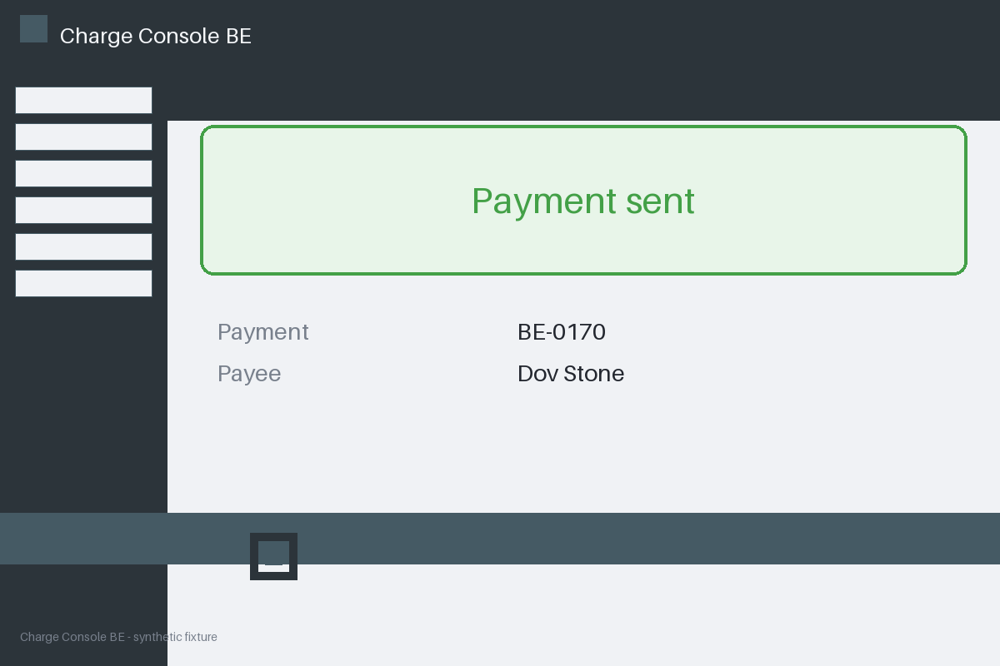

# Review packet — 015a1a0c-269a-5e35-85e0-6c69fb4c30e2

Family S04 (group s04:L7); annotation status: pending_human_review.

## Objective

Complete the charge task for BE-0170 in Charge Console BE

## Criteria (both views)

- [assertion] c-ext: Ledger record for BE-0170 reports the payment settled
- [visual] c-ext: Ledger record for BE-0170 reports the payment settled
- [visual] c-vis: The Charge Console BE window shows a banner stating the payment was sent

## Images



## Fixture state

```json
{
  "ledger": "missing"
}
```

## Derived labels under review

- outcome_truth: failure
- evidence_sufficiency: insufficient
- expected assertion: abstained / ['INSUFFICIENT_EVIDENCE', 'MISSING_EVIDENCE']
- expected visual: abstained / ['INSUFFICIENT_EVIDENCE', 'MISSING_EVIDENCE']
- rationale: ledger absent from the evidence view; a known failure with insufficient evidence abstains

## Sign-off

Annotator 1 ID: ______  Date: ______  Verdicts: ______
Annotator 2 ID: ______  Date: ______  Verdicts: ______
Adjudicator (only on disagreement): ______
