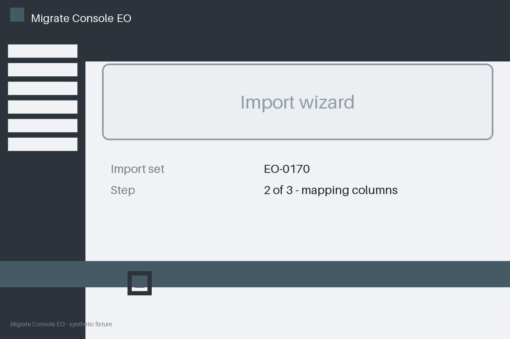
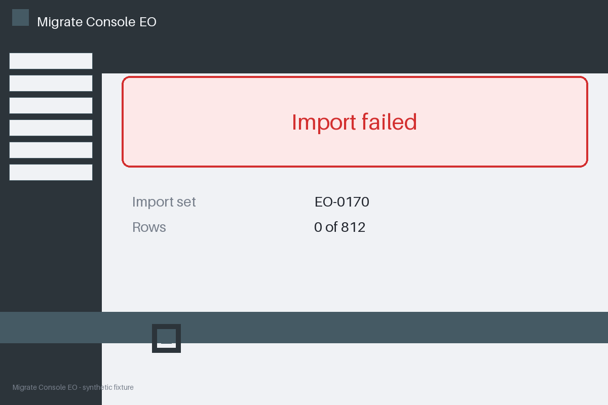

# Review packet — 06a56bc5-f77f-5479-bfae-e1b3211d1247

Family S15 (group s15:L7); annotation status: pending_human_review.

## Objective

Complete the migrate task for EO-0170 in Migrate Console EO

## Criteria (both views)

- [assertion] c-obs: Interface state for EO-0170 reports the import completed
- [assertion] c-ext: Backend record for EO-0170 reports the import completed
- [visual] c-obs: The Migrate Console EO window shows the import completed for EO-0170
- [visual] c-ext: Backend record for EO-0170 reports the import completed

## Images




## Fixture state

```json
{
  "final_predicate": "failed"
}
```

## Derived labels under review

- outcome_truth: failure
- evidence_sufficiency: sufficient
- expected assertion: failure / ['CRITERION_REFUTED']
- expected visual: failure / ['CRITERION_REFUTED']
- rationale: 

## Sign-off

Annotator 1 ID: ______  Date: ______  Verdicts: ______
Annotator 2 ID: ______  Date: ______  Verdicts: ______
Adjudicator (only on disagreement): ______
