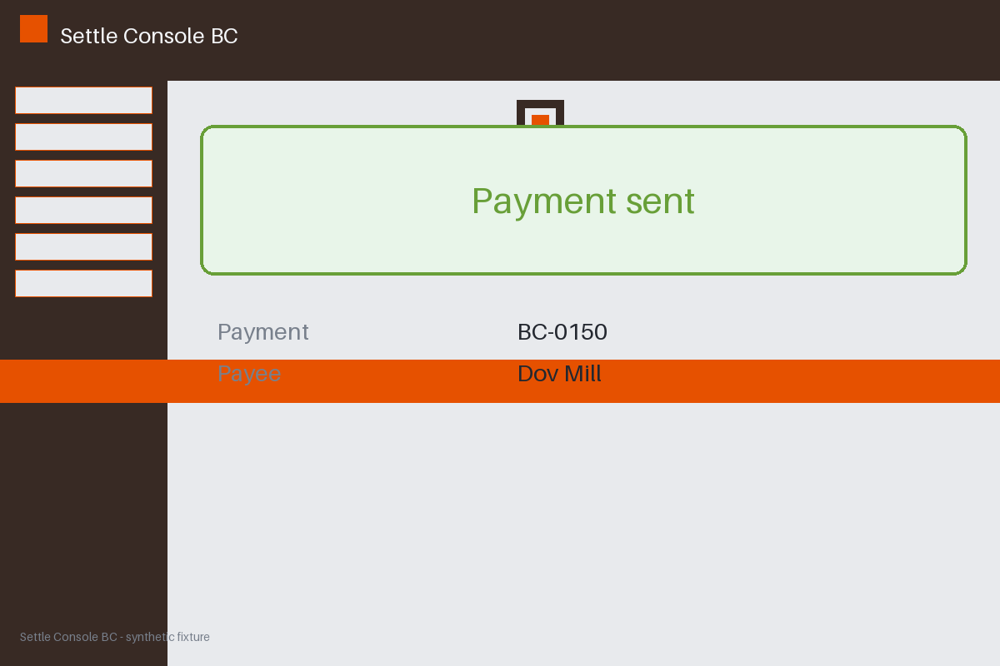

# Review packet — 14db4858-7f3b-57f4-9b8d-ad97f72204bc

Family S04 (group s04:L5); annotation status: pending_human_review.

## Objective

Complete the settle task for BC-0150 in Settle Console BC

## Criteria (both views)

- [assertion] c-ext: Ledger record for BC-0150 reports the payment settled
- [visual] c-ext: Ledger record for BC-0150 reports the payment settled
- [visual] c-vis: The Settle Console BC window shows a banner stating the payment was sent

## Images



## Fixture state

```json
{
  "ledger": "failed"
}
```

## Derived labels under review

- outcome_truth: failure
- evidence_sufficiency: sufficient
- expected assertion: failure / ['CRITERION_REFUTED']
- expected visual: failure / ['CRITERION_REFUTED']
- rationale: 

## Sign-off

Annotator 1 ID: ______  Date: ______  Verdicts: ______
Annotator 2 ID: ______  Date: ______  Verdicts: ______
Adjudicator (only on disagreement): ______
