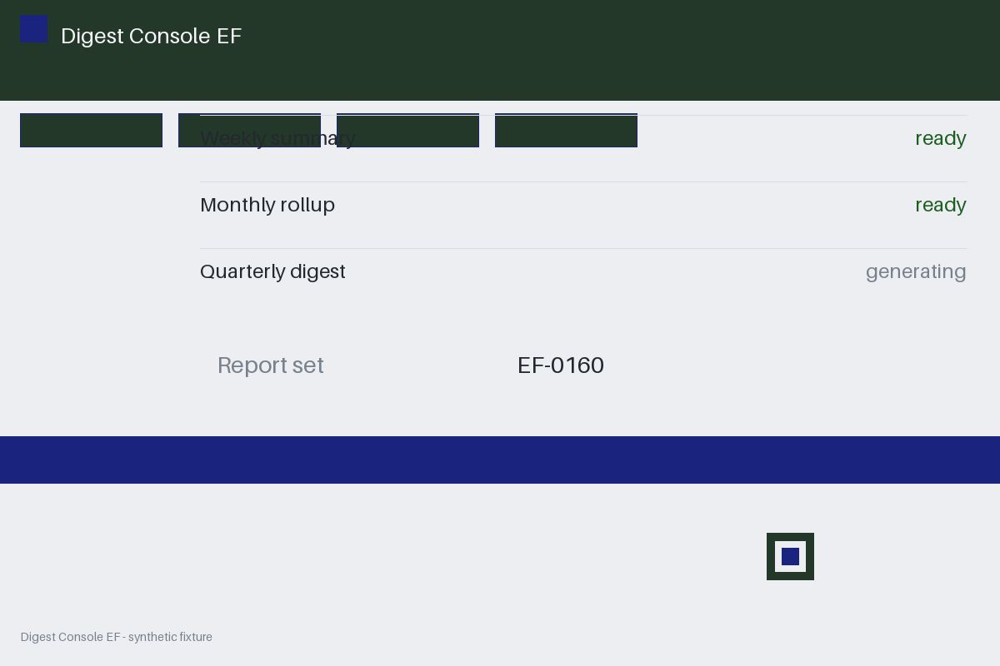

# Review packet — 18aa27c0-b629-5139-8e81-a69bc02e61f9

Family S14 (group s14:L6); annotation status: pending_human_review.

## Objective

Complete the digest task for EF-0160 in Digest Console EF

## Criteria (both views)

- [assertion] c-obs: Interface state for EF-0160 reports the confirmation banner present
- [visual] c-obs: The Digest Console EF window shows a confirmation banner for EF-0160

## Images



## Fixture state

```json
{
  "confirm_banner_present": false
}
```

## Derived labels under review

- outcome_truth: failure
- evidence_sufficiency: sufficient
- expected assertion: failure / ['CRITERION_REFUTED']
- expected visual: failure / ['CRITERION_REFUTED']
- rationale: the confirmation element the criterion names does not exist in the state

## Sign-off

Annotator 1 ID: ______  Date: ______  Verdicts: ______
Annotator 2 ID: ______  Date: ______  Verdicts: ______
Adjudicator (only on disagreement): ______
