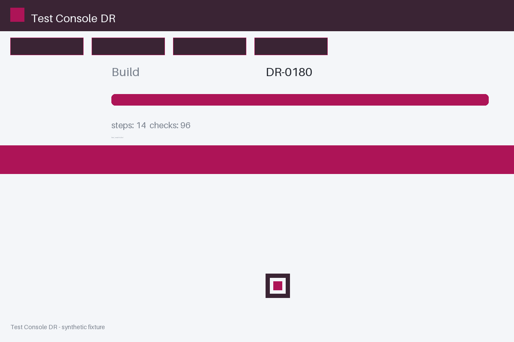

# Review packet — 27b84d82-fbe9-5fed-a8e2-7098deeeba46

Family S12 (group s12:L8); annotation status: pending_human_review.

## Objective

Complete the test task for DR-0180 in Test Console DR

## Criteria (both views)

- [assertion] c-obs: Interface state for DR-0180 reports the final result passed
- [visual] c-obs: The Test Console DR window shows the final result for DR-0180

## Images



## Fixture state

```json
{
  "decisive_key_present": false,
  "underlying": "failure"
}
```

## Derived labels under review

- outcome_truth: failure
- evidence_sufficiency: insufficient
- expected assertion: abstained / ['INSUFFICIENT_EVIDENCE', 'MISSING_VALUE']
- expected visual: abstained / ['INSUFFICIENT_EVIDENCE', 'MODEL_UNCERTAIN']
- rationale: the decisive detail is unreadable/absent from the evidence; unknown expectation

## Sign-off

Annotator 1 ID: ______  Date: ______  Verdicts: ______
Annotator 2 ID: ______  Date: ______  Verdicts: ______
Adjudicator (only on disagreement): ______
