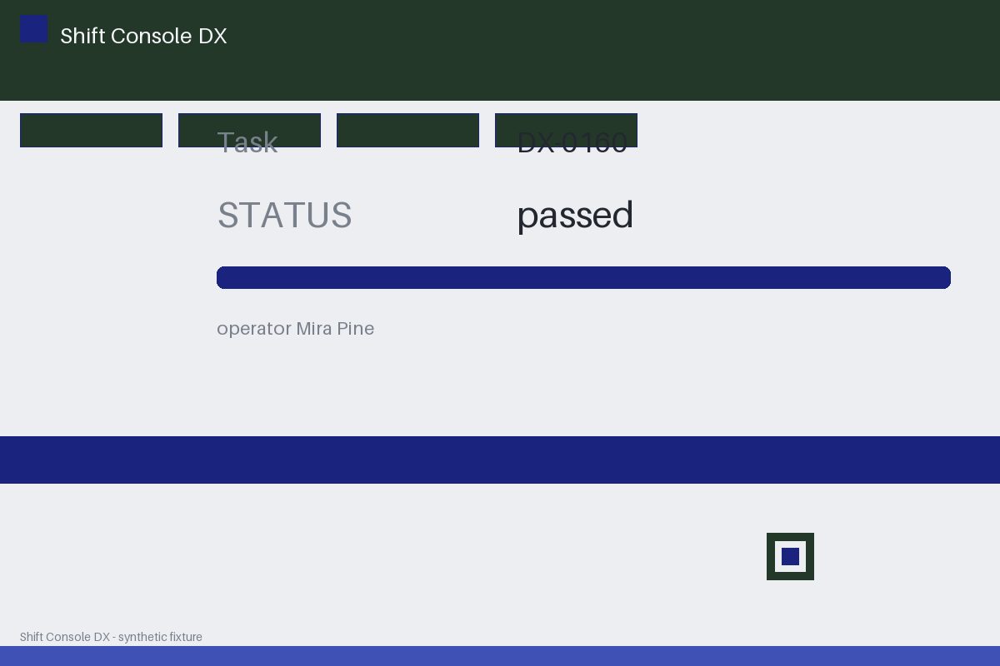

# Review packet — 37519544-7ec1-583c-af34-0b957f51ae57

Family S13 (group s13:L6); annotation status: pending_human_review.

## Objective

Complete the shift task for DX-0160 in Shift Console DX

## Criteria (both views)

- [assertion] c-obs: Interface state for DX-0160 reports STATUS passed
- [visual] c-obs: The Shift Console DX window shows STATUS passed for DX-0160

## Images



## Fixture state

```json
{
  "pair_kind": "irrelevant_edit",
  "status_line": "passed"
}
```

## Derived labels under review

- outcome_truth: success
- evidence_sufficiency: sufficient
- expected assertion: success / ['ALL_CRITERIA_SUPPORTED']
- expected visual: success / ['ALL_CRITERIA_SUPPORTED']
- rationale: 

## Sign-off

Annotator 1 ID: ______  Date: ______  Verdicts: ______
Annotator 2 ID: ______  Date: ______  Verdicts: ______
Adjudicator (only on disagreement): ______
