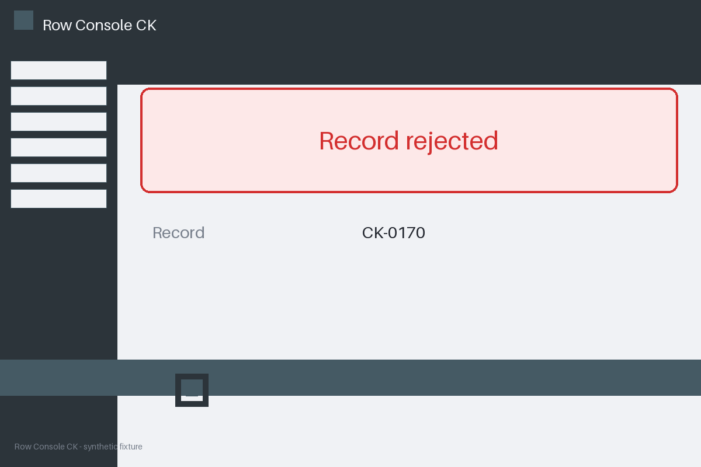

# Review packet — 3e0cccf0-497f-5fd8-85ce-112e101c14c6

Family S08 (group s08:L7); annotation status: pending_human_review.

## Objective

Complete the row task for CK-0170 in Row Console CK

## Criteria (both views)

- [assertion] c-obs: Storage record for CK-0170 reports status completed
- [visual] c-obs: The Row Console CK window shows a completion banner for CK-0170

## Images



## Fixture state

```json
{
  "underlying": "failure"
}
```

## Derived labels under review

- outcome_truth: failure
- evidence_sufficiency: insufficient
- expected assertion: abstained / ['INSUFFICIENT_EVIDENCE', 'MISSING_EVIDENCE']
- expected visual: abstained / ['INSUFFICIENT_EVIDENCE', 'MISSING_EVIDENCE']
- rationale: empty evidence view; truth is known to the fixture but not established by evidence

## Sign-off

Annotator 1 ID: ______  Date: ______  Verdicts: ______
Annotator 2 ID: ______  Date: ______  Verdicts: ______
Adjudicator (only on disagreement): ______
