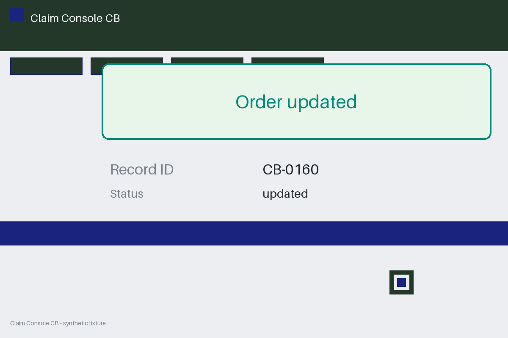

# Review packet — 474376a2-f41b-530b-b36d-806ed9657823

Family S07 (group s07:L6); annotation status: pending_human_review.

## Objective

Complete the claim task for CB-0160 in Claim Console CB

## Criteria (both views)

- [assertion] c-obs: Interface names record CB-0999
- [assertion] c-ext: Backend names record CB-0160
- [visual] c-obs: The Claim Console CB page names record CB-0999
- [visual] c-ext: Backend names record CB-0160

## Images



## Fixture state

```json
{
  "criterion_id": "CB-0999",
  "variant": "wrong_id",
  "visible_id": "CB-0160"
}
```

## Derived labels under review

- outcome_truth: failure
- evidence_sufficiency: sufficient
- expected assertion: failure / ['CRITERION_REFUTED']
- expected visual: failure / ['CRITERION_REFUTED']
- rationale: 

## Sign-off

Annotator 1 ID: ______  Date: ______  Verdicts: ______
Annotator 2 ID: ______  Date: ______  Verdicts: ______
Adjudicator (only on disagreement): ______
