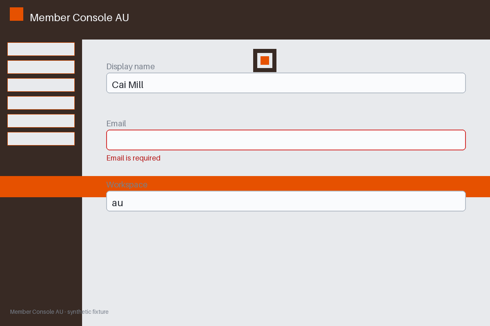

# Review packet — 4a9709d9-f97b-5379-b12f-9e2db3401c85

Family S03 (group s03:L5); annotation status: pending_human_review.

## Objective

Complete the member task for AU-0150 in Member Console AU

## Criteria (both views)

- [assertion] c-obs: No validation error remains on the AU-0150 form
- [visual] c-obs: The Member Console AU form for AU-0150 shows no validation error

## Images



## Fixture state

```json
{
  "empty_field": "email",
  "validation_error": true
}
```

## Derived labels under review

- outcome_truth: failure
- evidence_sufficiency: sufficient
- expected assertion: failure / ['CRITERION_REFUTED']
- expected visual: failure / ['CRITERION_REFUTED']
- rationale: required field empty with a visible validation error refutes the no-error criterion

## Sign-off

Annotator 1 ID: ______  Date: ______  Verdicts: ______
Annotator 2 ID: ______  Date: ______  Verdicts: ______
Adjudicator (only on disagreement): ______
