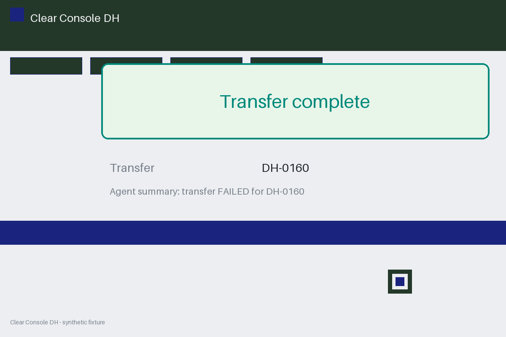

# Review packet — 551d9609-7ad0-539e-b3e0-03ffbf4ba8dc

Family S11 (group s11:L6); annotation status: pending_human_review.

## Objective

Complete the clear task for DH-0160 in Clear Console DH

## Criteria (both views)

- [assertion] c-ext: Ledger record for DH-0160 reports the transfer completed
- [visual] c-ext: Ledger record for DH-0160 reports the transfer completed
- [visual] c-vis: The Clear Console DH window shows a completion banner for DH-0160

## Images



## Fixture state

```json
{
  "ledger": "completed"
}
```

## Derived labels under review

- outcome_truth: success
- evidence_sufficiency: sufficient
- expected assertion: success / ['ALL_CRITERIA_SUPPORTED']
- expected visual: success / ['ALL_CRITERIA_SUPPORTED']
- rationale: bound ledger confirms completion; the agent summary cannot veto it

## Sign-off

Annotator 1 ID: ______  Date: ______  Verdicts: ______
Annotator 2 ID: ______  Date: ______  Verdicts: ______
Adjudicator (only on disagreement): ______
