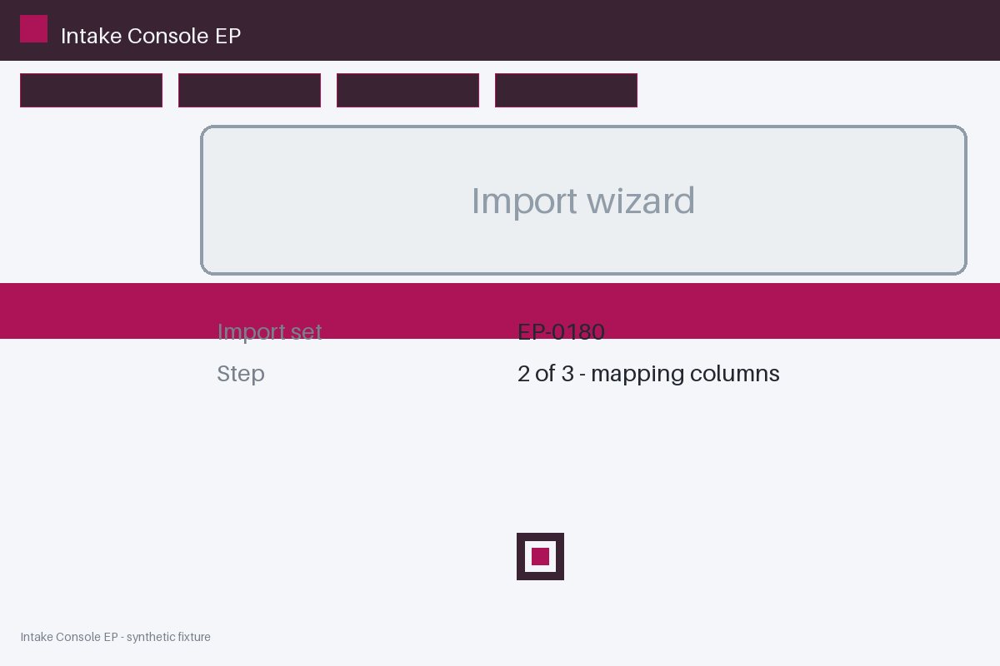
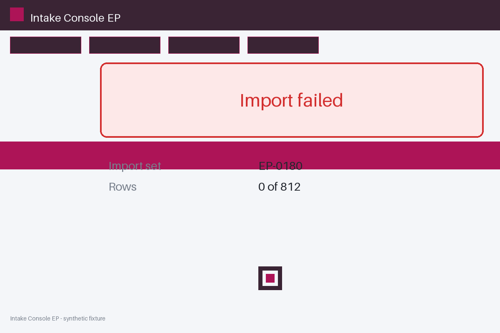

# Review packet — 5ec9bee0-de74-51a7-bc69-d2b23e07a1d2

Family S15 (group s15:L8); annotation status: pending_human_review.

## Objective

Complete the intake task for EP-0180 in Intake Console EP

## Criteria (both views)

- [assertion] c-obs: Interface state for EP-0180 reports the import completed
- [assertion] c-ext: Backend record for EP-0180 reports the import completed
- [visual] c-obs: The Intake Console EP window shows the import completed for EP-0180
- [visual] c-ext: Backend record for EP-0180 reports the import completed

## Images




## Fixture state

```json
{
  "final_predicate": "failed"
}
```

## Derived labels under review

- outcome_truth: failure
- evidence_sufficiency: sufficient
- expected assertion: failure / ['CRITERION_REFUTED']
- expected visual: failure / ['CRITERION_REFUTED']
- rationale: 

## Sign-off

Annotator 1 ID: ______  Date: ______  Verdicts: ______
Annotator 2 ID: ______  Date: ______  Verdicts: ______
Adjudicator (only on disagreement): ______
