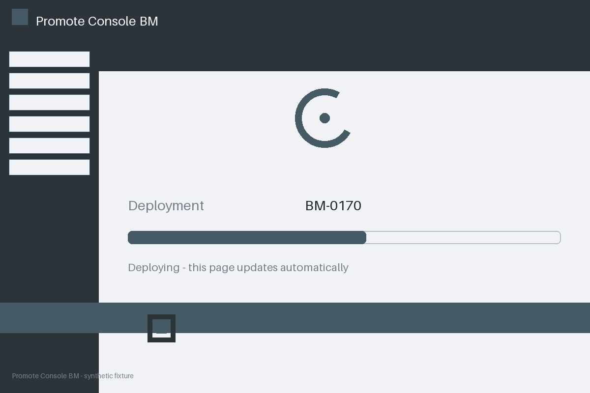

# Review packet — 62c7c4d9-e535-5bf0-a269-4965887aaed5

Family S05 (group s05:L7); annotation status: pending_human_review.

## Objective

Complete the promote task for BM-0170 in Promote Console BM

## Criteria (both views)

- [assertion] c-obs: Interface state for BM-0170 reports the deployment completed
- [visual] c-obs: The Promote Console BM window shows a final completion state for BM-0170

## Images



## Fixture state

```json
{
  "phase": "pending"
}
```

## Derived labels under review

- outcome_truth: unknown
- evidence_sufficiency: sufficient
- expected assertion: abstained / ['INSUFFICIENT_EVIDENCE', 'PENDING_STATE']
- expected visual: abstained / ['INSUFFICIENT_EVIDENCE', 'PENDING_STATE']
- rationale: pending phase is explicitly nonfinal; unknown, never failure

## Sign-off

Annotator 1 ID: ______  Date: ______  Verdicts: ______
Annotator 2 ID: ______  Date: ______  Verdicts: ______
Adjudicator (only on disagreement): ______
