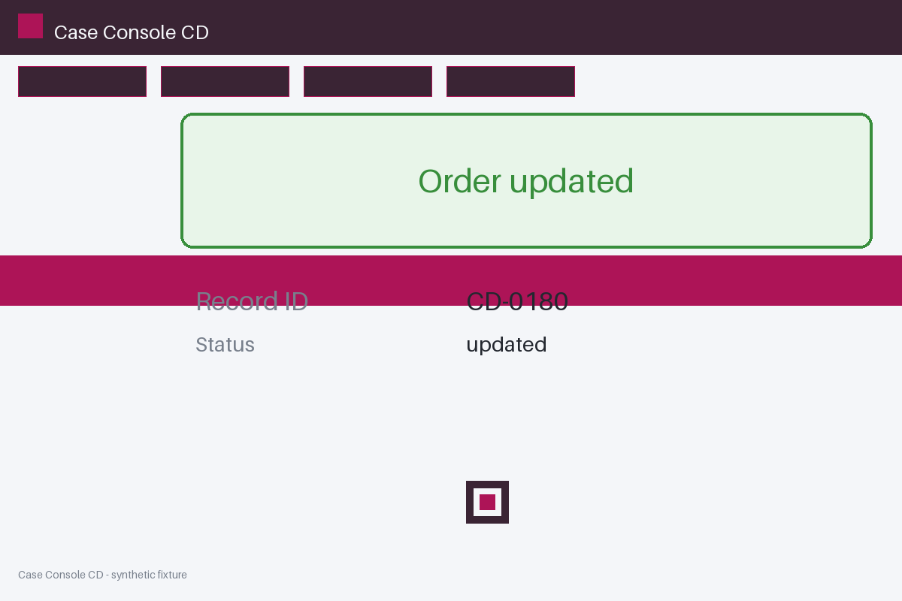

# Review packet — 6d1da7a6-2e70-5afd-b15b-0cfa6b1c70fa

Family S07 (group s07:L8); annotation status: pending_human_review.

## Objective

Complete the case task for CD-0180 in Case Console CD

## Criteria (both views)

- [assertion] c-obs: Interface names record CD-0999
- [assertion] c-ext: Backend names record CD-0180
- [visual] c-obs: The Case Console CD page names record CD-0999
- [visual] c-ext: Backend names record CD-0180

## Images



## Fixture state

```json
{
  "criterion_id": "CD-0999",
  "variant": "wrong_id",
  "visible_id": "CD-0180"
}
```

## Derived labels under review

- outcome_truth: failure
- evidence_sufficiency: sufficient
- expected assertion: failure / ['CRITERION_REFUTED']
- expected visual: failure / ['CRITERION_REFUTED']
- rationale: 

## Sign-off

Annotator 1 ID: ______  Date: ______  Verdicts: ______
Annotator 2 ID: ______  Date: ______  Verdicts: ______
Adjudicator (only on disagreement): ______
