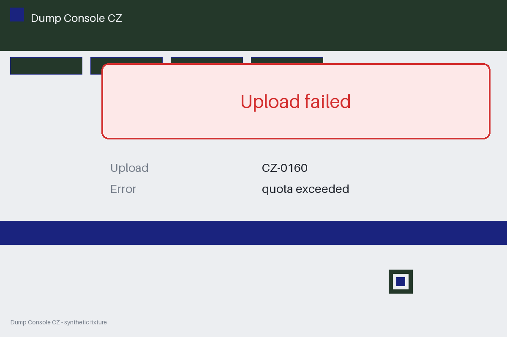

# Review packet — 819bc6aa-ff5d-513e-a422-d671f1019f3a

Family S10 (group s10:L6); annotation status: pending_human_review.

## Objective

Complete the dump task for CZ-0160 in Dump Console CZ

## Criteria (both views)

- [assertion] c-beh: The upload action for CZ-0160 completed
- [assertion] c-ext: Backend record for CZ-0160 reports the upload stored
- [visual] c-beh: The upload action for CZ-0160 completed
- [visual] c-ext: Backend record for CZ-0160 reports the upload stored

## Images



## Fixture state

```json
{
  "action": "completed",
  "final_status": "failed"
}
```

## Derived labels under review

- outcome_truth: failure
- evidence_sufficiency: sufficient
- expected assertion: failure / ['CRITERION_REFUTED']
- expected visual: failure / ['CRITERION_REFUTED']
- rationale: behavior completed but the required final state failed; behavior cannot override

## Sign-off

Annotator 1 ID: ______  Date: ______  Verdicts: ______
Annotator 2 ID: ______  Date: ______  Verdicts: ______
Adjudicator (only on disagreement): ______
