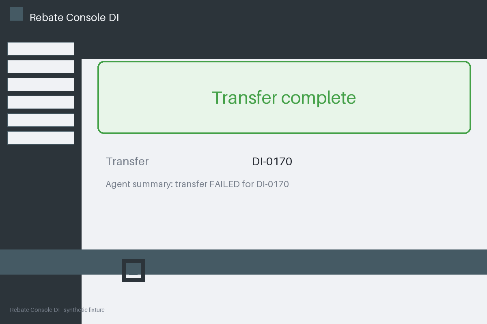

# Review packet — 90db5d91-6abb-5d45-bcd5-e70105f8178a

Family S11 (group s11:L7); annotation status: pending_human_review.

## Objective

Complete the rebate task for DI-0170 in Rebate Console DI

## Criteria (both views)

- [assertion] c-ext: Ledger record for DI-0170 reports the transfer completed
- [visual] c-ext: Ledger record for DI-0170 reports the transfer completed
- [visual] c-vis: The Rebate Console DI window shows a completion banner for DI-0170

## Images



## Fixture state

```json
{
  "ledger": "completed"
}
```

## Derived labels under review

- outcome_truth: success
- evidence_sufficiency: sufficient
- expected assertion: success / ['ALL_CRITERIA_SUPPORTED']
- expected visual: success / ['ALL_CRITERIA_SUPPORTED']
- rationale: bound ledger confirms completion; the agent summary cannot veto it

## Sign-off

Annotator 1 ID: ______  Date: ______  Verdicts: ______
Annotator 2 ID: ______  Date: ______  Verdicts: ______
Adjudicator (only on disagreement): ______
