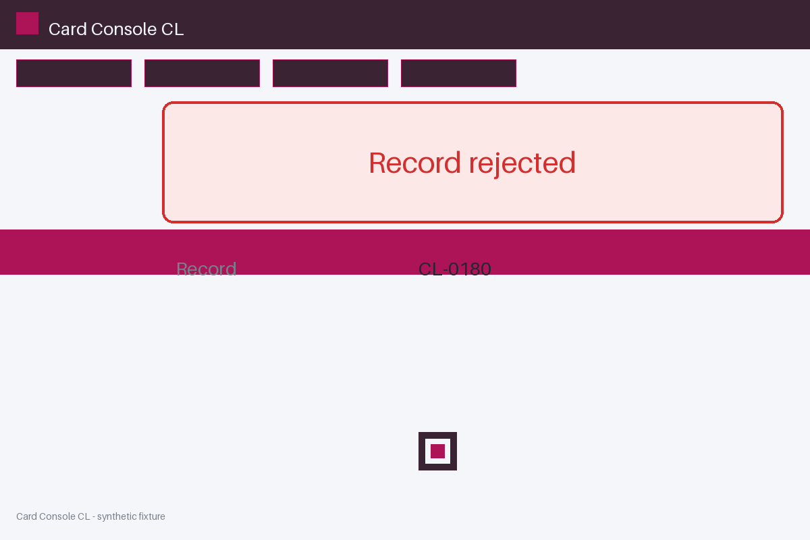

# Review packet — 91a387bf-687b-5a9a-90ca-a9797b88a8fe

Family S08 (group s08:L8); annotation status: pending_human_review.

## Objective

Complete the card task for CL-0180 in Card Console CL

## Criteria (both views)

- [assertion] c-obs: Storage record for CL-0180 reports status completed
- [visual] c-obs: The Card Console CL window shows a completion banner for CL-0180

## Images



## Fixture state

```json
{
  "underlying": "failure"
}
```

## Derived labels under review

- outcome_truth: failure
- evidence_sufficiency: insufficient
- expected assertion: abstained / ['INSUFFICIENT_EVIDENCE', 'MISSING_EVIDENCE']
- expected visual: abstained / ['INSUFFICIENT_EVIDENCE', 'MISSING_EVIDENCE']
- rationale: empty evidence view; truth is known to the fixture but not established by evidence

## Sign-off

Annotator 1 ID: ______  Date: ______  Verdicts: ______
Annotator 2 ID: ______  Date: ______  Verdicts: ______
Adjudicator (only on disagreement): ______
