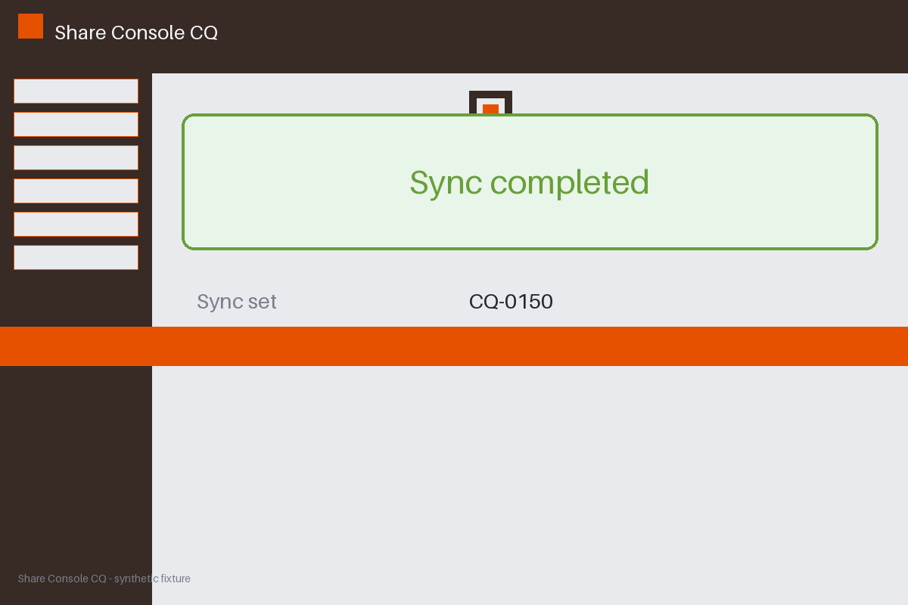
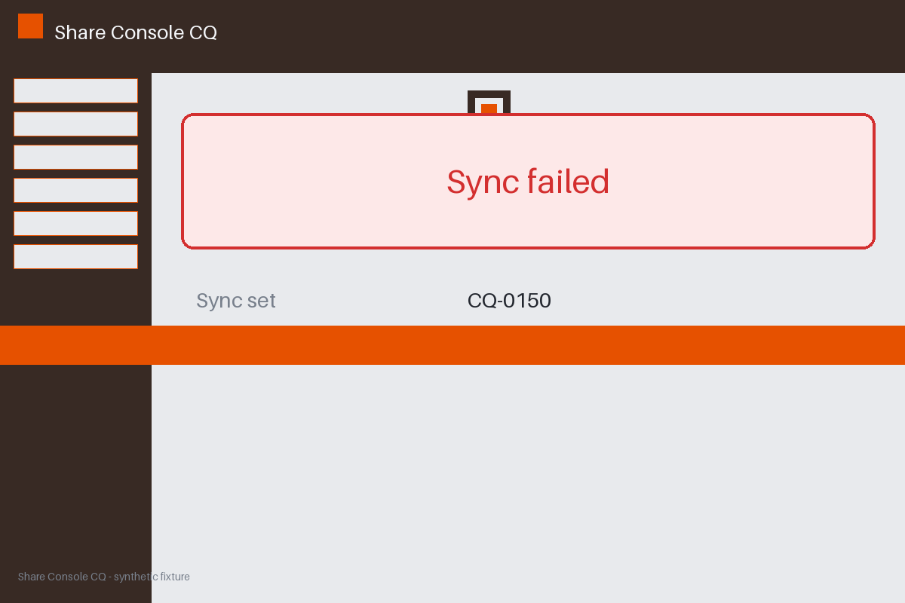

# Review packet — 95049a74-01b3-5d79-9abb-f372a83a139f

Family S09 (group s09:L5); annotation status: pending_human_review.

## Objective

Complete the share task for CQ-0150 in Share Console CQ

## Criteria (both views)

- [assertion] c-obs: Interface state for CQ-0150 reports the sync completed
- [visual] c-obs: The Share Console CQ window shows a completion banner for CQ-0150

## Images




## Fixture state

```json
{
  "contradiction": true
}
```

## Derived labels under review

- outcome_truth: unknown
- evidence_sufficiency: contradictory
- expected assertion: abstained / ['INSUFFICIENT_EVIDENCE', 'CONTRADICTORY_EVIDENCE']
- expected visual: abstained / ['INSUFFICIENT_EVIDENCE', 'CONTRADICTORY_EVIDENCE']
- rationale: two final snapshots contradict on one criterion; unknown, never source-count

## Sign-off

Annotator 1 ID: ______  Date: ______  Verdicts: ______
Annotator 2 ID: ______  Date: ______  Verdicts: ______
Adjudicator (only on disagreement): ______
