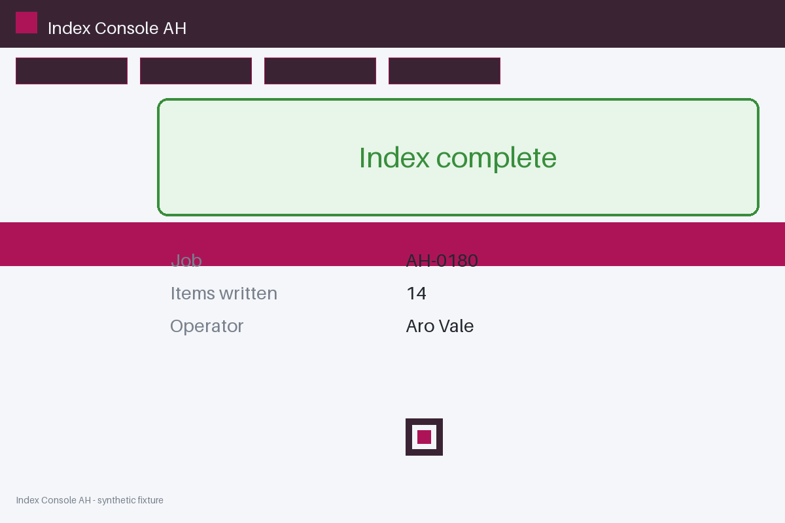

# Review packet — 9a1b04de-aed0-52b9-a36f-8120801d68af

Family S01 (group s01:L8); annotation status: pending_human_review.

## Objective

Complete the index task for AH-0180 in Index Console AH

## Criteria (both views)

- [assertion] c-ext: Backend record for AH-0180 reports status completed
- [assertion] c-obs: Interface state for AH-0180 reports the index completed
- [visual] c-ext: Backend record for AH-0180 reports status completed
- [visual] c-obs: The Index Console AH window shows a banner stating the index completed

## Images



## Fixture state

```json
{
  "final_status": "completed",
  "items": 14
}
```

## Derived labels under review

- outcome_truth: success
- evidence_sufficiency: sufficient
- expected assertion: success / ['ALL_CRITERIA_SUPPORTED']
- expected visual: success / ['ALL_CRITERIA_SUPPORTED']
- rationale: final completion state confirmed by interface and bound backend record

## Sign-off

Annotator 1 ID: ______  Date: ______  Verdicts: ______
Annotator 2 ID: ______  Date: ______  Verdicts: ______
Adjudicator (only on disagreement): ______
