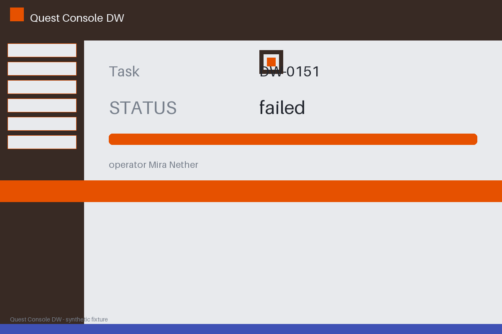

# Review packet — 9fa57b64-0b17-5e49-b8cf-eed1e47c7012

Family S13 (group s13:L5); annotation status: pending_human_review.

## Objective

Complete the quest task for DW-0151 in Quest Console DW

## Criteria (both views)

- [assertion] c-obs: Interface state for DW-0151 reports STATUS passed
- [visual] c-obs: The Quest Console DW window shows STATUS passed for DW-0151

## Images



## Fixture state

```json
{
  "pair_kind": "counterfactual",
  "status_line": "failed"
}
```

## Derived labels under review

- outcome_truth: failure
- evidence_sufficiency: sufficient
- expected assertion: failure / ['CRITERION_REFUTED']
- expected visual: failure / ['CRITERION_REFUTED']
- rationale: 

## Sign-off

Annotator 1 ID: ______  Date: ______  Verdicts: ______
Annotator 2 ID: ______  Date: ______  Verdicts: ______
Adjudicator (only on disagreement): ______
