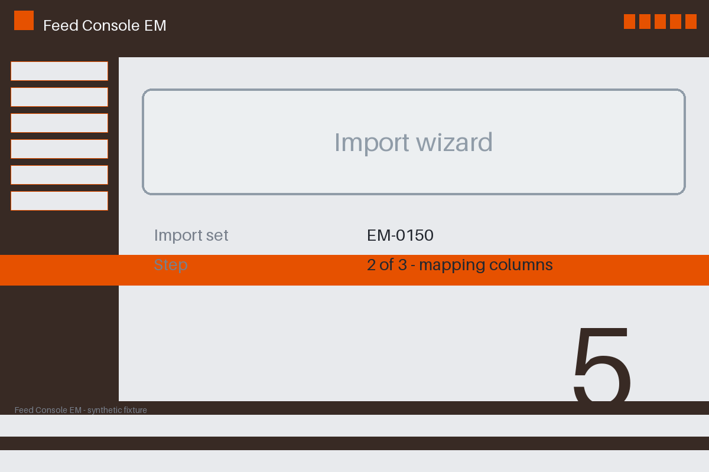

# Review packet — a82e857b-aeb2-5e64-820c-2a53f03aa4b5

Family S15 (group s15:L5); annotation status: pending_human_review.

## Objective

Complete the feed task for EM-0150 in Feed Console EM

## Criteria (both views)

- [assertion] c-ext: Backend record for EM-0150 reports the import completed
- [visual] c-ext: Backend record for EM-0150 reports the import completed

## Images



## Fixture state

```json
{
  "final_predicate": "absent"
}
```

## Derived labels under review

- outcome_truth: unknown
- evidence_sufficiency: insufficient
- expected assertion: abstained / ['INSUFFICIENT_EVIDENCE', 'MISSING_EVIDENCE']
- expected visual: abstained / ['INSUFFICIENT_EVIDENCE', 'MISSING_EVIDENCE']
- rationale: history cannot substitute for the missing final predicate

## Sign-off

Annotator 1 ID: ______  Date: ______  Verdicts: ______
Annotator 2 ID: ______  Date: ______  Verdicts: ______
Adjudicator (only on disagreement): ______
