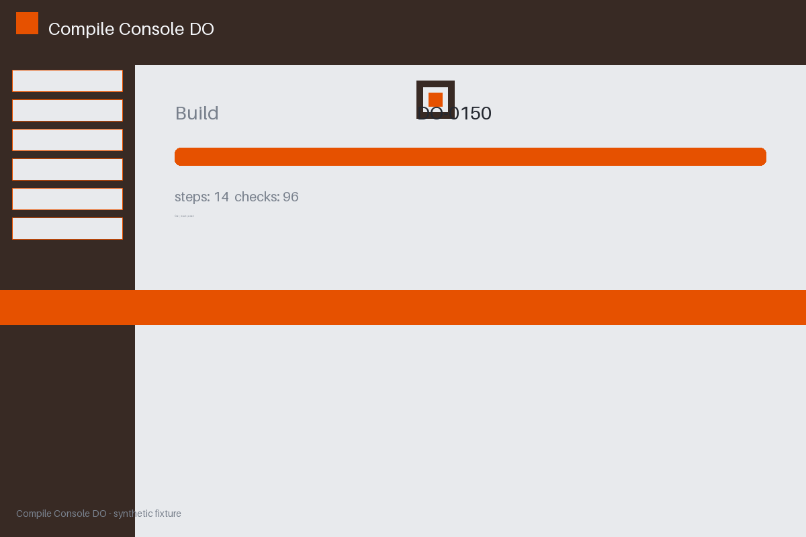

# Review packet — b8d02e3b-4fca-5e4d-8d23-a212004cc519

Family S12 (group s12:L5); annotation status: pending_human_review.

## Objective

Complete the compile task for DO-0150 in Compile Console DO

## Criteria (both views)

- [assertion] c-obs: Interface state for DO-0150 reports the final result passed
- [visual] c-obs: The Compile Console DO window shows the final result for DO-0150

## Images



## Fixture state

```json
{
  "decisive_key_present": false,
  "underlying": "success"
}
```

## Derived labels under review

- outcome_truth: success
- evidence_sufficiency: insufficient
- expected assertion: abstained / ['INSUFFICIENT_EVIDENCE', 'MISSING_VALUE']
- expected visual: abstained / ['INSUFFICIENT_EVIDENCE', 'MODEL_UNCERTAIN']
- rationale: the decisive detail is unreadable/absent from the evidence; unknown expectation

## Sign-off

Annotator 1 ID: ______  Date: ______  Verdicts: ______
Annotator 2 ID: ______  Date: ______  Verdicts: ______
Adjudicator (only on disagreement): ______
