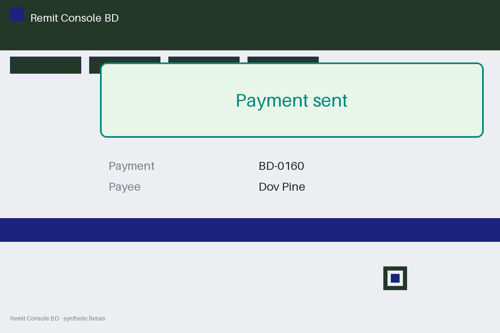

# Review packet — b91a3673-35e0-58e1-b652-1f371f39f8d2

Family S04 (group s04:L6); annotation status: pending_human_review.

## Objective

Complete the remit task for BD-0160 in Remit Console BD

## Criteria (both views)

- [assertion] c-ext: Ledger record for BD-0160 reports the payment settled
- [visual] c-ext: Ledger record for BD-0160 reports the payment settled
- [visual] c-vis: The Remit Console BD window shows a banner stating the payment was sent

## Images



## Fixture state

```json
{
  "ledger": "failed"
}
```

## Derived labels under review

- outcome_truth: failure
- evidence_sufficiency: sufficient
- expected assertion: failure / ['CRITERION_REFUTED']
- expected visual: failure / ['CRITERION_REFUTED']
- rationale: 

## Sign-off

Annotator 1 ID: ______  Date: ______  Verdicts: ______
Annotator 2 ID: ______  Date: ______  Verdicts: ______
Adjudicator (only on disagreement): ______
