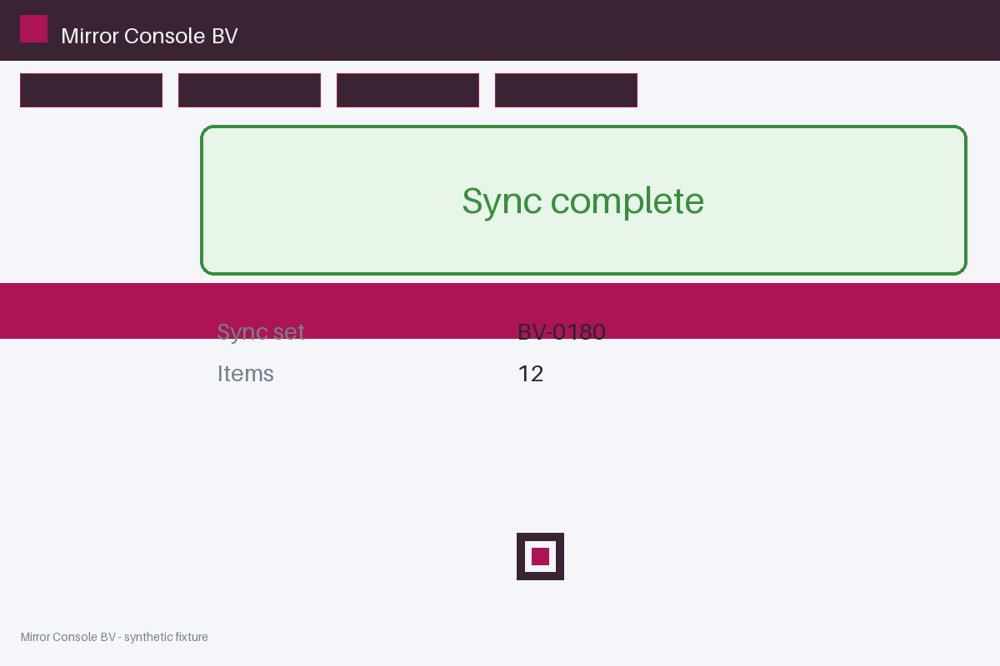

# Review packet — c5d4e603-e16d-5e54-9fce-045acf705d4a

Family S06 (group s06:L8); annotation status: pending_human_review.

## Objective

Complete the mirror task for BV-0180 in Mirror Console BV

## Criteria (both views)

- [assertion] c-ext: Database record for BV-0180 reports the sync completed
- [visual] c-ext: Database record for BV-0180 reports the sync completed

## Images



## Fixture state

```json
{
  "database_status": "failed"
}
```

## Derived labels under review

- outcome_truth: failure
- evidence_sufficiency: sufficient
- expected assertion: failure / ['CRITERION_REFUTED']
- expected visual: abstained / ['INSUFFICIENT_EVIDENCE', 'MISSING_EVIDENCE']
- rationale: database observation refutes completion; the image-only view withholds it and abstains

## Sign-off

Annotator 1 ID: ______  Date: ______  Verdicts: ______
Annotator 2 ID: ______  Date: ______  Verdicts: ______
Adjudicator (only on disagreement): ______
