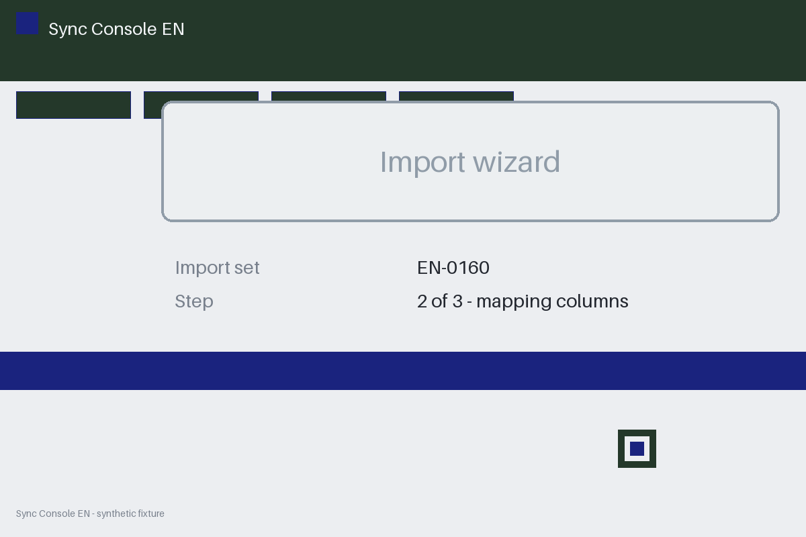

# Review packet — cf0e37db-891d-51e5-84f1-fa7ebaace986

Family S15 (group s15:L6); annotation status: pending_human_review.

## Objective

Complete the sync task for EN-0160 in Sync Console EN

## Criteria (both views)

- [assertion] c-obs: Interface state for EN-0160 reports the import completed
- [assertion] c-ext: Backend record for EN-0160 reports the import completed
- [visual] c-obs: The Sync Console EN window shows the import completed for EN-0160
- [visual] c-ext: Backend record for EN-0160 reports the import completed

## Images



## Fixture state

```json
{
  "final_predicate": "absent"
}
```

## Derived labels under review

- outcome_truth: unknown
- evidence_sufficiency: insufficient
- expected assertion: abstained / ['INSUFFICIENT_EVIDENCE', 'MISSING_EVIDENCE']
- expected visual: abstained / ['INSUFFICIENT_EVIDENCE', 'MISSING_EVIDENCE']
- rationale: history cannot substitute for the missing final predicate

## Sign-off

Annotator 1 ID: ______  Date: ______  Verdicts: ______
Annotator 2 ID: ______  Date: ______  Verdicts: ______
Adjudicator (only on disagreement): ______
