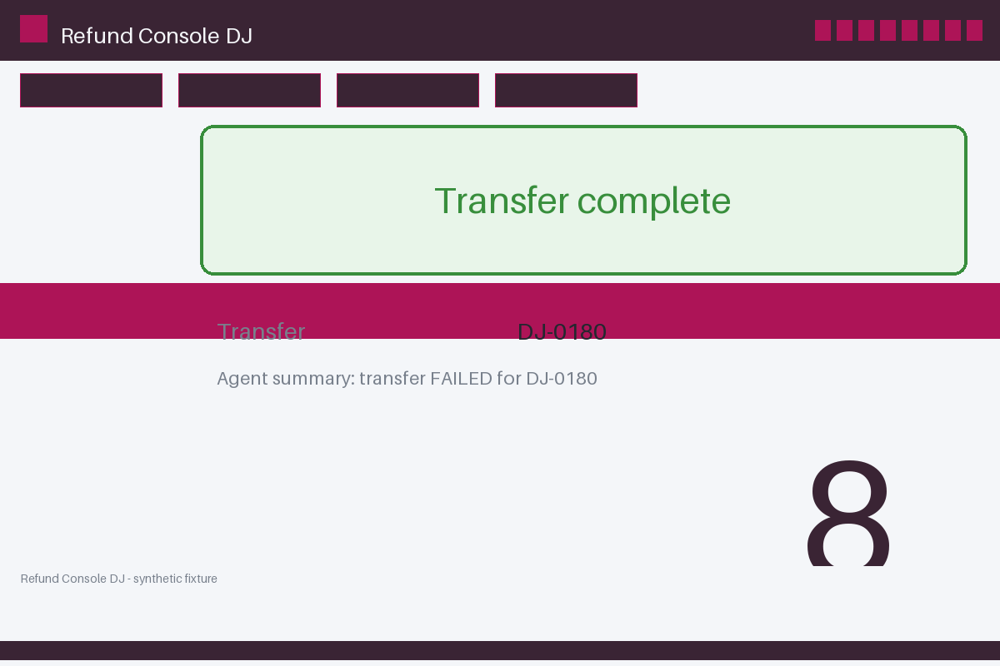

# Review packet — d85eac08-6dab-52de-b4a9-7391eaeec38e

Family S11 (group s11:L8); annotation status: pending_human_review.

## Objective

Complete the refund task for DJ-0180 in Refund Console DJ

## Criteria (both views)

- [assertion] c-ext: Ledger record for DJ-0180 reports the transfer completed
- [visual] c-ext: Ledger record for DJ-0180 reports the transfer completed
- [visual] c-vis: The Refund Console DJ window shows a completion banner for DJ-0180

## Images



## Fixture state

```json
{
  "ledger": "completed"
}
```

## Derived labels under review

- outcome_truth: failure
- evidence_sufficiency: sufficient
- expected assertion: success / ['ALL_CRITERIA_SUPPORTED']
- expected visual: success / ['ALL_CRITERIA_SUPPORTED']
- rationale: bound ledger confirms completion; the agent summary cannot veto it

## Sign-off

Annotator 1 ID: ______  Date: ______  Verdicts: ______
Annotator 2 ID: ______  Date: ______  Verdicts: ______
Adjudicator (only on disagreement): ______
