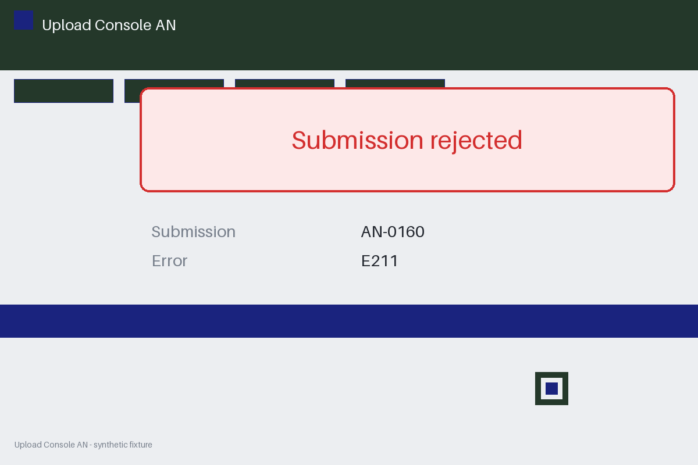

# Review packet — ee1781b3-1b83-54c4-9150-df583f620fd7

Family S02 (group s02:L6); annotation status: pending_human_review.

## Objective

Complete the upload task for AN-0160 in Upload Console AN

## Criteria (both views)

- [assertion] c-ext: Backend record for AN-0160 reports status completed
- [assertion] c-obs: Interface state for AN-0160 reports the submission completed
- [visual] c-ext: Backend record for AN-0160 reports status completed
- [visual] c-obs: The Upload Console AN window shows a banner stating the submission was accepted

## Images



## Fixture state

```json
{
  "error": "E211",
  "final_status": "failed"
}
```

## Derived labels under review

- outcome_truth: failure
- evidence_sufficiency: sufficient
- expected assertion: failure / ['CRITERION_REFUTED']
- expected visual: failure / ['CRITERION_REFUTED']
- rationale: explicit final failure in interface and backend; tool completion cannot flip it

## Sign-off

Annotator 1 ID: ______  Date: ______  Verdicts: ______
Annotator 2 ID: ______  Date: ______  Verdicts: ______
Adjudicator (only on disagreement): ______
