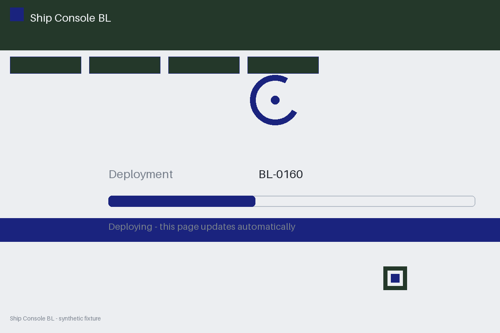

# Review packet — f3d1a4a5-d090-56fc-80bb-528457d58b8b

Family S05 (group s05:L6); annotation status: pending_human_review.

## Objective

Complete the ship task for BL-0160 in Ship Console BL

## Criteria (both views)

- [assertion] c-obs: Interface state for BL-0160 reports the deployment completed
- [visual] c-obs: The Ship Console BL window shows a final completion state for BL-0160

## Images



## Fixture state

```json
{
  "phase": "pending"
}
```

## Derived labels under review

- outcome_truth: unknown
- evidence_sufficiency: sufficient
- expected assertion: abstained / ['INSUFFICIENT_EVIDENCE', 'PENDING_STATE']
- expected visual: abstained / ['INSUFFICIENT_EVIDENCE', 'PENDING_STATE']
- rationale: pending phase is explicitly nonfinal; unknown, never failure

## Sign-off

Annotator 1 ID: ______  Date: ______  Verdicts: ______
Annotator 2 ID: ______  Date: ______  Verdicts: ______
Adjudicator (only on disagreement): ______
