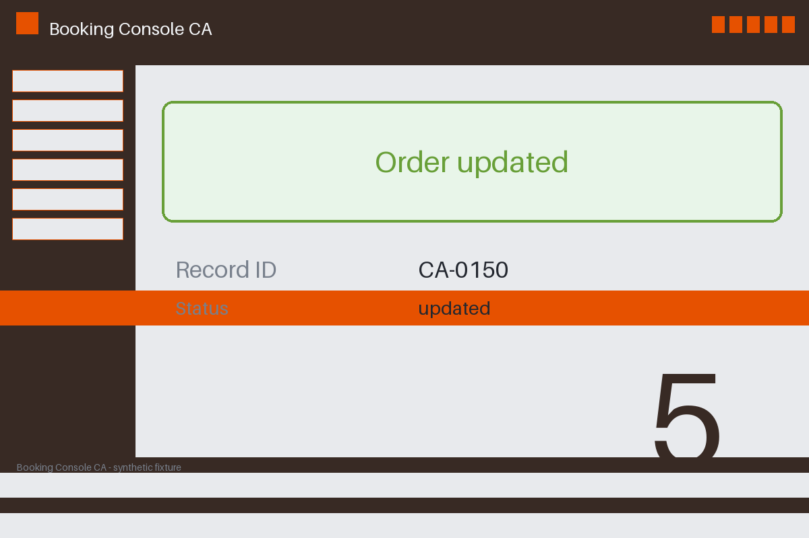

# Review packet — f4467e8a-bbfb-5917-9fdb-4692f577d399

Family S07 (group s07:L5); annotation status: pending_human_review.

## Objective

Complete the booking task for CA-0150 in Booking Console CA

## Criteria (both views)

- [assertion] c-obs: Interface names record CA-0999
- [visual] c-obs: Interface names record CA-0999

## Images



## Fixture state

```json
{
  "criterion_id": "CA-0999",
  "variant": "subject_mismatch",
  "visible_id": "CA-0150"
}
```

## Derived labels under review

- outcome_truth: failure
- evidence_sufficiency: insufficient
- expected assertion: abstained / ['INSUFFICIENT_EVIDENCE', 'SUBJECT_MISMATCH']
- expected visual: abstained / ['INSUFFICIENT_EVIDENCE', 'SUBJECT_MISMATCH']
- rationale: evidence names a different record than the criterion subject; unknown, not failure

## Sign-off

Annotator 1 ID: ______  Date: ______  Verdicts: ______
Annotator 2 ID: ______  Date: ______  Verdicts: ______
Adjudicator (only on disagreement): ______
