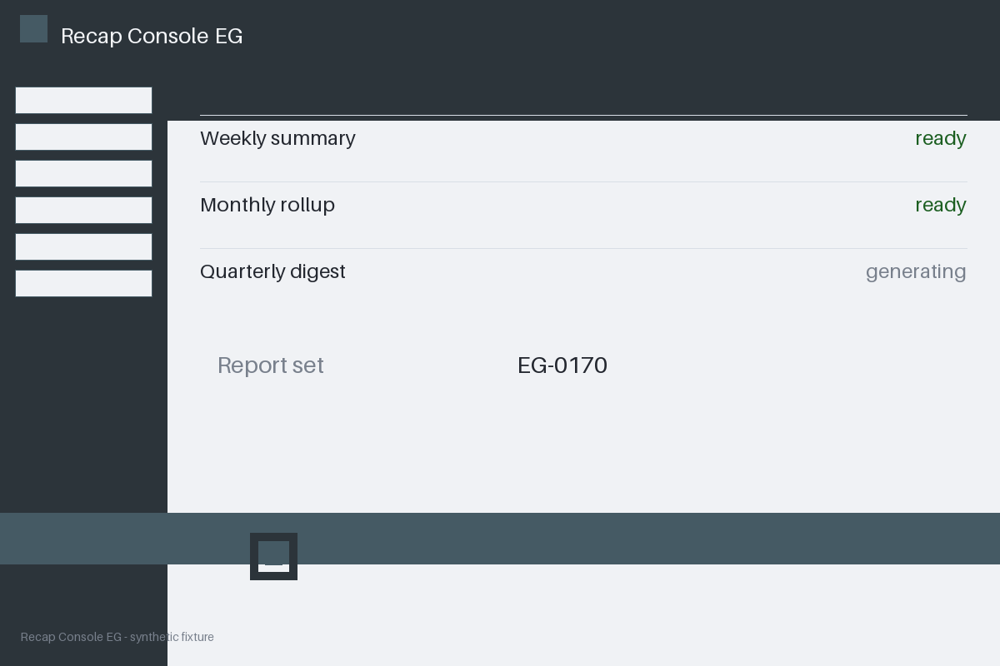

# Review packet — fcea3a59-8cca-550b-9eb6-9ee24d0ad824

Family S14 (group s14:L7); annotation status: pending_human_review.

## Objective

Complete the recap task for EG-0170 in Recap Console EG

## Criteria (both views)

- [assertion] c-obs: Interface state for EG-0170 reports the confirmation banner present
- [visual] c-obs: The Recap Console EG window shows a confirmation banner for EG-0170

## Images



## Fixture state

```json
{
  "confirm_banner_present": false
}
```

## Derived labels under review

- outcome_truth: failure
- evidence_sufficiency: sufficient
- expected assertion: failure / ['CRITERION_REFUTED']
- expected visual: failure / ['CRITERION_REFUTED']
- rationale: the confirmation element the criterion names does not exist in the state

## Sign-off

Annotator 1 ID: ______  Date: ______  Verdicts: ______
Annotator 2 ID: ______  Date: ______  Verdicts: ______
Adjudicator (only on disagreement): ______
