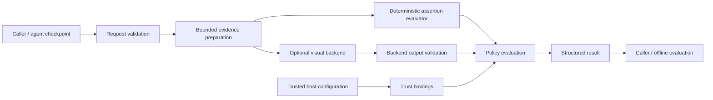

# System architecture

Normative dependencies: [domain/API contract](03-domain-model-and-api.md), [policy algorithm](05-evidence-and-policies.md), [MVP scope](09-mvp-scope.md). Proposed module paths below are implementation instructions, not existing source files.

## Boundary and data flow

Nitelos observes caller-supplied snapshots. It never owns execution, clicks buttons, follows screenshot instructions, queries a URL found in evidence, or retries an agent's action. A caller captures browser state or obtains read-only external confirmation using its own authorized integration. A result is a time-scoped judgment, not a transaction guarantee.

## Modules and dependency direction

| Proposed module | Responsibility | Forbidden responsibility |
|---|---|---|
| `schemas.py` | Public Pydantic models, discriminated unions, serialization | Provider imports, I/O, trust establishment |
| `errors.py` | Stable safe error codes and public exceptions | Raw prompt/credential exception text |
| `evidence.py` | Artifact bytes, digest validation, image decoding, refs | Fetch arbitrary URLs or infer authenticity |
| `backends/base.py` | Capabilities, normalized findings, backend protocol | Aggregate policy decisions |
| `backends/deterministic.py` | Fixed JSON-pointer assertion operators | Python eval, SQL, regex, browser control |
| `backends/smolvlm.py` | Optional local processor/model adapter | Set trust, fabricate probabilities, download on verify |
| `policy.py` | Criterion admissibility, contradictions, all-required aggregation | Model invocation, arbitrary callbacks |
| `verifier.py` | Validation and execution order, sync/async facade, safe errors | Provider-dependent judgment semantics |
| `trace.py` | Bounded schema-v1 JSON trace import | Parse arbitrary trace archives or replay tools |
| `evaluation/` | Manifest loading, per-case execution, metrics, report | Expose hidden labels to backend |
| `diagnostics.py` | Safe timings/IDs/version fields | Raw evidence logging or global exporters |

Dependencies flow toward schemas/protocols. Core imports neither Torch, Transformers, SciPy nor a browser package. Optional modules import their dependencies only when explicitly constructed/used. One package with extras is sufficient: no network service or database needs independent deployment or scaling in v0.1.

## Invocation lifecycle

1. Validate input mapping or typed request and policy. Assign a UUID verification ID. Preserve a valid caller request ID; otherwise null. Constructor validation is separate from execution errors.
2. Enforce aggregate byte/count/depth limits before expensive work. Resolve declared artifact bytes from the explicit in-memory artifact store; validate all supplied artifacts, including unused ones. No paths or URLs are implicitly opened.
3. Validate criteria, artifact references, unique IDs, source/subject/checkpoint bindings, and capabilities. A declared unsupported criterion is an input error before any model runs.
4. Prepare immutable evidence and compute hashes. Match runtime trust bindings to exact hashes. Never promote JSON claims to authority.
5. Run assertion criteria in request order using the deterministic evaluator. Run visual criteria in request order using the explicitly supplied visual backend. The default deterministic-only configuration rejects visual criteria. Do not skip a failing backend because another criterion already failed; evaluation accounting must be consistent.
6. Validate every normalized backend finding against criterion ID, allowed states, evidence refs, finite score semantics, and backend capability declaration. Any invalid output fails the invocation with `backend_error`; partial findings may be diagnostics but the overall decision is null.
7. Apply policy per criterion, then aggregate. Missing admissible evidence is an abstention condition. Refuted final evidence is failure. Pending evidence cannot establish a final-state failure.
8. Return a JSON-safe result with input/policy/backend fingerprints and safe diagnostics. Do not persist artifacts or report by default.

## Sync, async, resources

The backend protocol is synchronous in v0.1. `Verifier.verify` is the canonical method. `Verifier.averify` is an async facade that delegates the entire invocation to a bounded worker, avoiding event-loop blocking. Native async provider execution is deferred. One in-flight call per verifier instance; concurrent use returns `backend_error/BUSY`. This avoids hidden thread pools with unbounded queues and unsafe sharing of a local model.

`close()` is idempotent; context management releases the verifier's backend resources. The verifier owns its backend instance after construction; sharing one backend among verifier instances is unsupported. Calls after close return `backend_error/CLOSED`. Cancellation of `averify` propagates `CancelledError` and produces no successful result. A worker already running cannot be forcibly killed by thread cancellation: retain busy state until it actually ends; close waits for completion. Document this limitation. Hard isolation/time limits require a caller-owned process in v0.1, not a misleading async timeout promise.

Local generation has bounded input/output tokens and a cooperative stopping deadline checked between generation steps. A single kernel/load can exceed that deadline. Report `TIMEOUT` when observed; never falsely claim hard wall-time enforcement. Evaluation runner concurrency defaults to one and supports no multi-process distributed mode.

## Integration surfaces

Python SDK supports arbitrary applications and agent frameworks without lifecycle migration. JSON trace import accepts only Nitelos's schema. A documentation recipe uses a caller's Playwright screenshot and normalized locator observations; it adds no runtime Playwright dependency. CI uses the SDK or evaluation module command. REST, general CLI, native Playwright adapter and Inspect scorer are future work.

## Diagnostics and observability

Result diagnostics contain request/verification IDs; package/schema versions; backend ID/version and model ID/revision; prompt/preprocessing fingerprints; policy ID/version/hash; calibration ID (null in shipped adapters); evidence manifest hash; elapsed wall milliseconds; per-criterion durations; usage/cost/memory values only if actually measured. Cost includes currency, price-source timestamp and estimated/measured flag if ever supported. CPU/GPU peak memory is measured in isolated evaluation runs, not guessed from model size. Unavailable fields are null with a reason.

Use the standard `logging` module with no installed handlers and no stdout writes. Log only safe event names, counts, duration, and codes at normal levels; even debug logging excludes raw objectives, trace bodies, images, paths, provider responses and exception strings. IDs/hashes are linkable metadata; the caller controls log retention. Later OpenTelemetry adapters emit a single verification span and bounded criterion events using the [upstream conventions](https://opentelemetry.io/docs/specs/semconv/gen-ai/), without a core dependency.

## Performance expectations

Assertions are linear in criteria and referenced observations, plus hashing/decoding overhead. Prepared images are reused across criteria but model inference is once per visual criterion. Sequential calls intentionally favor predictability over throughput. The local model is loaded once per backend, lazily on first visual use, from a pre-provisioned directory. Loading time is reported separately from warm inference. No response cache is provided; evidence deduplication must not merge different provenance events.
