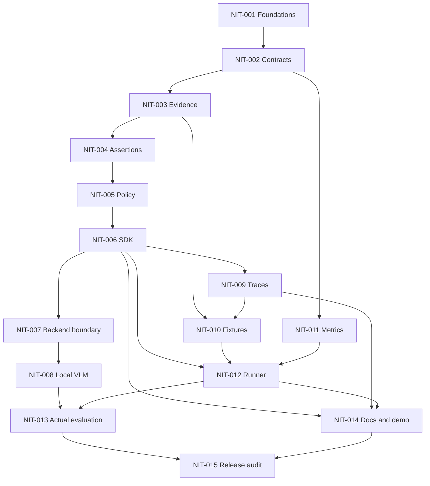

# Implementation roadmap for GLM 5.3

This is a future execution plan, not authorization for the planning agent to implement. Complete one ticket at a time. All paths below are proposed. No feature may bypass [MVP scope](09-mvp-scope.md) or the [normative contract](03-domain-model-and-api.md).

## Phases and dependency graph

Phase 0 establishes schema/evidence; phase 1 closes an offline deterministic vertical slice; phase 2 adds real visual inference; phase 3 imports bounded traces; phase 4 measures reliability; phase 5 prepares release. NIT-011 may run after contracts while core work continues; NIT-009 may run alongside NIT-007/008 after SDK completion; documentation may run beside final evaluation after its dependencies. These are parallelizable work boundaries, not instructions to spawn agents. Within a single coding-agent session use numeric order unless a blocker justifies another dependency-ready task. Evidence→assertions→policy→SDK must remain sequential. No final-test run before data/protocol freeze.

The model critical path is 001→002→003→004→005→006→007→008→013→015. The fixture/evaluation branch 006→009→010→012→013 can be equally limiting; staffing/hardware/annotation availability determine actual duration. Complexity S≈one focused coding slice, M≈several focused slices, L≈multiple slices with integration/review; these are not calendar promises.

## Shared ticket definition of done (normative for every ticket)

For each ticket: write the listed failing tests first and observe the intended failure; implement the minimum described behavior; run the ticket command; run regression tests for its dependencies; run Ruff format/check and strict mypy; inspect diff for unrelated changes, secrets and interface drift; update task status with evidence and deviations. No xfail/skip can hide a required gate. A task is done only when its exact acceptance criteria and this definition both hold. A docs/research-only subtask may use a review/checklist rather than meaningless implementation-mirroring tests. Live integration skips are allowed in ordinary CI but do not satisfy the release integration gate.

## Architectural review checkpoints

- **AR-1 after NIT-002:** author reviews schema/error semantics and examples before evidence/policy code depends on them.
- **AR-2 after NIT-006:** review trust bindings, contradiction table, error conversion, cancellation limits and offline demo. No model integration before this review.
- **AR-3 after NIT-008:** review actual inference report, dependency/license changes and valid-output rate. A failed model gate requires a documented decision; GLM cannot silently replace it.
- **AR-4 before NIT-013:** approve frozen dataset groups/oracles, input views, metrics, prompt/config and negative-result reporting. Final labels are not tuning inputs.
- **AR-5 after NIT-015:** maintainer reviews release evidence and publication permissions; publishing is separate.

A core-contract change at any time requires a written ADR amendment, migration/test impact and author approval before implementation. Routine choices within documented interfaces do not need repeated approval. If a checkpoint reviewer is unavailable, continue only independent dependency-ready work and report the block; elapsed time is not approval.

## NIT-001 — Repository foundations and reproducible core tooling

- **Phase:** 0.
- **Objective:** Repository foundations and reproducible core tooling.
- **Dependencies:** None.
- **Required inputs:** Documents 03, 08, 09, 11 and 12; empty application workspace.
- **Expected deliverables / files:** `pyproject.toml`, `uv.lock`, `src/nitelos/__init__.py`, `src/nitelos/py.typed`, `tests/test_packaging.py`, `.github/workflows/ci.yml`, development instructions.
- **Interfaces affected:** Package import and public version only; do not stub verification success.
- **Test-first requirements and demonstrated behavior:** PKG-01: built wheel imports without local/eval extras and without network. PKG-02: wheel includes py.typed and no weights/secrets. PKG-03: supported Python metadata matches 3.12/3.13. Begin with an import test that fails before creating the package.
- **Minimum implementation:** Create minimal src-layout package, strict tool configuration, core/dev lock and a core-only CI job. Resolve actual tested dependency versions and license entries; do not select optional model versions yet.
- **Implementation constraints:** Follow documents 03/05/07; no unrelated refactors, no silent scope expansion, no fabricated results. Application behavior, model download, all backend implementations.
- **Exact acceptance criteria:** Frozen core/dev sync succeeds on declared matrix; import has no side effects; wheel and sdist build; Ruff/mypy/packaging tests pass; record exact license of development tools.
- **Expected failure behavior:** Dependency resolution failure is an explicit blocker. Never disable strict checks or install unreviewed model extras to resolve it.
- **Regression tests:** All dependency-ticket tests plus the full offline suite at the phase checkpoint; add a regression for every discovered behavior defect before fixing it.
- **Verification command:** uv run pytest tests/test_packaging.py -q.
- **Definition of done:** Shared ticket DoD above plus this ticket's acceptance evidence, test output and reviewed deviations recorded in the implementation task log.
- **Estimated complexity:** S (one focused slice).
- **Explicit exclusions:** Application behavior, model download, all backend implementations.

## NIT-002 — Strict domain models and schema snapshots

- **Phase:** 0.
- **Objective:** Strict domain models and schema snapshots.
- **Dependencies:** NIT-001.
- **Required inputs:** Document 03 field tables, legal states, limits and error taxonomy.
- **Expected deliverables / files:** `schemas.py`, `errors.py`, `tests/test_contract.py`, `tests/schemas/*.json`.
- **Interfaces affected:** VerificationRequest, Criterion unions, Evidence unions, Score, CriterionResult, VerificationResult, parse_request.
- **Test-first requirements and demonstrated behavior:** CON-01: all five legal status/decision combinations pass, every other combination fails. CON-02: mapping round trip preserves order/nulls. CON-03: duplicate keys/IDs, bool coercion, non-finite values, extra fields and unknown schema fail with safe field paths. CON-04: timezone/string boundary behavior and immutable input copies. Write these failing tests first.
- **Minimum implementation:** Implement only schemas, safe parsers, bounded JSON parsing and stable error models. Export reviewed JSON Schema snapshots; do not infer criteria from objective.
- **Implementation constraints:** Follow documents 03/05/07; no unrelated refactors, no silent scope expansion, no fabricated results. I/O, inference, calibration registry, invented optional fields.
- **Exact acceptance criteria:** Every field in document 03 has a tested type/default/bound; exact error/decision invariant holds; input values never appear in validation errors; JSON schema snapshots are reviewed.
- **Expected failure behavior:** parse_request raises safe RequestValidationError; verify's later wrapper will convert it. Constructor mistakes remain documented validation exceptions.
- **Regression tests:** All dependency-ticket tests plus the full offline suite at the phase checkpoint; add a regression for every discovered behavior defect before fixing it.
- **Verification command:** uv run pytest tests/test_contract.py -q.
- **Definition of done:** Shared ticket DoD above plus this ticket's acceptance evidence, test output and reviewed deviations recorded in the implementation task log.
- **Estimated complexity:** M.
- **Explicit exclusions:** I/O, inference, calibration registry, invented optional fields.

## NIT-003 — Evidence bytes, hashes, references and bounds

- **Phase:** 0.
- **Objective:** Evidence bytes, hashes, references and bounds.
- **Dependencies:** NIT-002.
- **Required inputs:** Documents 03, 05 and 07; synthetic tiny byte fixtures only.
- **Expected deliverables / files:** `evidence.py`, `tests/test_evidence.py`, `tests/test_security.py` (SEC-05/06).
- **Interfaces affected:** ArtifactStore, Evidence helper constructors, EvidenceRef validation, prepared evidence internal type.
- **Test-first requirements and demonstrated behavior:** EVD-01 known byte SHA and canonical JSON SHA. EVD-02 missing store entry vs empty evidence list. EVD-03 duplicate bytes preserve separate event IDs. EVD-04 boxes at boundaries. SEC-05 invalid signature, truncated JPEG, animation, over-limit dimensions and orientation. SEC-06 byte/count/depth max and max+1. Write failing tests before loader code.
- **Minimum implementation:** Immutable in-memory artifacts, deterministic digest checks, bounded Pillow decode, exact dimensions/MIME checks, explicit RGB conversion metadata and safe repr.
- **Implementation constraints:** Follow documents 03/05/07; no unrelated refactors, no silent scope expansion, no fabricated results. URL fetching, redaction, OCR, graph store, archive extraction.
- **Exact acceptance criteria:** No network or path access exists in core evidence loading; corrupt unused artifacts also reject request; all documented ceilings enforced before model invocation; source bytes remain unchanged.
- **Expected failure behavior:** MISSING_ARTIFACT, INVALID_IMAGE, HASH_MISMATCH or LIMIT_EXCEEDED input errors; no placeholder image or swallowed decode error.
- **Regression tests:** All dependency-ticket tests plus the full offline suite at the phase checkpoint; add a regression for every discovered behavior defect before fixing it.
- **Verification command:** uv run pytest tests/test_evidence.py tests/test_security.py -q.
- **Definition of done:** Shared ticket DoD above plus this ticket's acceptance evidence, test output and reviewed deviations recorded in the implementation task log.
- **Estimated complexity:** M.
- **Explicit exclusions:** URL fetching, redaction, OCR, graph store, archive extraction.

## NIT-004 — Deterministic assertion evaluator

- **Phase:** 1.
- **Objective:** Deterministic assertion evaluator.
- **Dependencies:** NIT-003.
- **Required inputs:** Document 04 pointer/operator semantics; prepared eligible evidence.
- **Expected deliverables / files:** `backends/deterministic.py`, `tests/test_deterministic.py`.
- **Interfaces affected:** Internal assertion-to-finding flow; default DeterministicBackend descriptor.
- **Test-first requirements and demonstrated behavior:** DET-01 equals/in/exists on scalars, null and containers. DET-02 missing key/out-of-range => unknown. DET-03 escaped ~0/~1 keys and invalid escapes/array indices. DET-04 bool differs from 1, numeric 1 equals 1.0. DET-05 injection strings stay literal. Tests first with hand-written expected values.
- **Minimum implementation:** Pure pointer traversal and three fixed operators, per-reference checked findings; no policy trust decisions in evaluator.
- **Implementation constraints:** Follow documents 03/05/07; no unrelated refactors, no silent scope expansion, no fabricated results. Browser assertions, HTML parsing, arbitrary callback predicates.
- **Exact acceptance criteria:** Every operator/edge case passes; evaluated pointer refs retained; no evaluation, subprocess, network, SQL or regex path.
- **Expected failure behavior:** Malformed pointers/expectations input_error; missing target unknown; present unequal final target refuted after eligibility supplied by policy.
- **Regression tests:** All dependency-ticket tests plus the full offline suite at the phase checkpoint; add a regression for every discovered behavior defect before fixing it.
- **Verification command:** uv run pytest tests/test_deterministic.py -q.
- **Definition of done:** Shared ticket DoD above plus this ticket's acceptance evidence, test output and reviewed deviations recorded in the implementation task log.
- **Estimated complexity:** S.
- **Explicit exclusions:** Browser assertions, HTML parsing, arbitrary callback predicates.

## NIT-005 — Evidence eligibility and pure policy aggregation

- **Phase:** 1.
- **Objective:** Evidence eligibility and pure policy aggregation.
- **Dependencies:** NIT-004.
- **Required inputs:** Document 05 ordered algorithm and examples; document 03 TrustBinding.
- **Expected deliverables / files:** `policy.py`, `tests/test_policy.py`, SEC-02 tests in `tests/test_security.py`.
- **Interfaces affected:** VerificationPolicy, TrustBinding, per-criterion eligibility, aggregate result semantics.
- **Test-first requirements and demonstrated behavior:** POL-01 all 27 three-criterion combinations. POL-02 supported/refuted contradiction => unknown; separate refuted criterion still => failure. POL-03 missing vs pending vs stale vs future timestamp. POL-04 exact source/digest/subject/checkpoint binding and expiration. POL-05 visual policy opt-in cannot enable external acceptance. SEC-02 forged JSON trust/source rejected. Write tables before implementation.
- **Minimum implementation:** Fixed configuration with only model opt-in; pure eligibility and aggregation functions; explicit reason ordering and limitations.
- **Implementation constraints:** Follow documents 03/05/07; no unrelated refactors, no silent scope expansion, no fabricated results. Risk classifiers, policy DSL, external collectors, calibrated confidence enforcement.
- **Exact acceptance criteria:** Zero success for unbound external facts across adversarial cases; all-required conjunction matches table; digest/context substitution fails; supported evidence plus missing observation follows documented rule.
- **Expected failure behavior:** Ineligible evidence yields ok/unknown with precise reason; structural errors fail input; no score threshold/fusion fallback.
- **Regression tests:** All dependency-ticket tests plus the full offline suite at the phase checkpoint; add a regression for every discovered behavior defect before fixing it.
- **Verification command:** uv run pytest tests/test_policy.py tests/test_security.py -q.
- **Definition of done:** Shared ticket DoD above plus this ticket's acceptance evidence, test output and reviewed deviations recorded in the implementation task log.
- **Estimated complexity:** M.
- **Explicit exclusions:** Risk classifiers, policy DSL, external collectors, calibrated confidence enforcement.

## NIT-006 — End-to-end verifier SDK and lifecycle

- **Phase:** 1.
- **Objective:** End-to-end verifier SDK and lifecycle.
- **Dependencies:** NIT-005.
- **Required inputs:** Documents 02/03 lifecycle, safe diagnostics and error semantics.
- **Expected deliverables / files:** `verifier.py`, `diagnostics.py`, public exports, `tests/test_verifier.py`, `tests/test_lifecycle.py`, SEC-03/04 tests.
- **Interfaces affected:** Verifier.verify, averify, close, context manager; VerificationResult diagnostics.
- **Test-first requirements and demonstrated behavior:** SDK-01 incomplete form returns failure; confirmed final state success; absent evidence abstained. SDK-02 structured invalid mapping input_error, no model calls. LIFE-01 concurrent call BUSY, closed call CLOSED, idempotent close. LIFE-02 async cancellation propagates and keeps worker busy until finished. SEC-03 secret sentinel absent from logs/results/repr; SEC-04 network forbidden. Tests use controlled fake blocking backend, not timing sleeps.
- **Minimum implementation:** Compose existing pure functions, collect monotonic timings, bounded single-flight async facade, sanitized exception conversion and context cleanup.
- **Implementation constraints:** Follow documents 03/05/07; no unrelated refactors, no silent scope expansion, no fabricated results. Native async provider protocol, thread-killing guarantees, persistent logging/export.
- **Exact acceptance criteria:** Default quickstart path works without model extras or network; timing fields are actual measurements; no result is success on execution failure; ownership/cancellation tests pass deterministically.
- **Expected failure behavior:** Backend exceptions map to safe error; cancellation/KeyboardInterrupt/SystemExit propagate; no automatic retries; partial results nonauthoritative.
- **Regression tests:** All dependency-ticket tests plus the full offline suite at the phase checkpoint; add a regression for every discovered behavior defect before fixing it.
- **Verification command:** uv run pytest tests/test_verifier.py tests/test_lifecycle.py tests/test_security.py -q.
- **Definition of done:** Shared ticket DoD above plus this ticket's acceptance evidence, test output and reviewed deviations recorded in the implementation task log.
- **Estimated complexity:** M.
- **Explicit exclusions:** Native async provider protocol, thread-killing guarantees, persistent logging/export.

## NIT-007 — Custom visual backend boundary and capability validation

- **Phase:** 2.
- **Objective:** Custom visual backend boundary and capability validation.
- **Dependencies:** NIT-006.
- **Required inputs:** Document 04 protocol, document 03 findings/scores.
- **Expected deliverables / files:** `backends/base.py`, contract validation in `verifier.py`, `tests/test_backend_contract.py`.
- **Interfaces affected:** BackendDescriptor, BackendCapabilities, Backend.infer, custom instance injection.
- **Test-first requirements and demonstrated behavior:** BAK-01 unsupported image count/kind rejects before infer. BAK-02 missing/duplicate/foreign criterion IDs, invented refs, out-of-bounds boxes, malformed state => backend_error. BAK-03 calibrated claim rejected; null and uncalibrated scores retained without affecting decision. BAK-04 custom backend cannot emit assertion_checked. BAK-05 wrong kind remains unsupported even if model inference disallowed. Tests first.
- **Minimum implementation:** Typed instance protocol and common finding validation, immutable prepared context, no registry or import-string loader.
- **Implementation constraints:** Follow documents 03/05/07; no unrelated refactors, no silent scope expansion, no fabricated results. Plugin discovery, provider clients, calibration acceptance.
- **Exact acceptance criteria:** A fake custom backend works via instance injection; invalid outputs cannot bypass policy or fabricate evidence; labels/oracle/trust config never enter model context.
- **Expected failure behavior:** Capability mismatches input_error, malformed inference output backend_error, valid unknown ok/abstained.
- **Regression tests:** All dependency-ticket tests plus the full offline suite at the phase checkpoint; add a regression for every discovered behavior defect before fixing it.
- **Verification command:** uv run pytest tests/test_backend_contract.py -q.
- **Definition of done:** Shared ticket DoD above plus this ticket's acceptance evidence, test output and reviewed deviations recorded in the implementation task log.
- **Estimated complexity:** M.
- **Explicit exclusions:** Plugin discovery, provider clients, calibration acceptance.

## NIT-008 — Real offline SmolVLM adapter

- **Phase:** 2.
- **Objective:** Real offline SmolVLM adapter.
- **Dependencies:** NIT-007.
- **Required inputs:** Document 04 exact procedure, model pin, reviewed optional dependency versions; implementation-phase permission to provision weights and access suitable hardware.
- **Expected deliverables / files:** `backends/smolvlm.py`, prompt resource, local extra/lock update, `tests/test_smolvlm_contract.py`, `tests/integration/test_local_model.py`, model compatibility report.
- **Interfaces affected:** SmolVLMBackend; no core schema change.
- **Test-first requirements and demonstrated behavior:** VLM-01 mocked processor preserves image order/placeholder count. VLM-02 decode only new tokens, strict label parser. VLM-03 valid UNKNOWN vs invalid output. VLM-04 local-files-only/remote-code false; missing optional dependency/model. VLM-05 token limits and declared preprocessing. SEC-01 injection payload treated as data; SEC-08 safe model loading. Write mocked tests first, then an opt-in actual CPU smoke test.
- **Minimum implementation:** Implement one checkpoint pipeline, lazy local loading, CPU float32, exact prompt/parser, cooperative deadline, model manifest and dependency lock. Run actual 12-case development smoke set and record results.
- **Implementation constraints:** Follow documents 03/05/07; no unrelated refactors, no silent scope expansion, no fabricated results. Training, quantization, alternate VLMs, hosted APIs, production accuracy guarantees.
- **Exact acceptance criteria:** Offline mocked tests pass; no automatic downloads; real CPU run produces at least one valid decisive label; all 12 statuses and actual timings recorded; exact version/model-file manifests reviewed. No accuracy invented or asserted from mocks.
- **Expected failure behavior:** Missing/load/resource/timeout/invalid labels map to designated backend errors. If genuine inference cannot meet validity gate, stop for architectural review; do not change model or fake output.
- **Regression tests:** All dependency-ticket tests plus the full offline suite at the phase checkpoint; add a regression for every discovered behavior defect before fixing it.
- **Verification command:** uv run pytest tests/test_smolvlm_contract.py -q; separately, NITELOS_RUN_LOCAL=1 integration command described in document 12.
- **Definition of done:** Shared ticket DoD above plus this ticket's acceptance evidence, test output and reviewed deviations recorded in the implementation task log.
- **Estimated complexity:** L (highest compatibility risk).
- **Explicit exclusions:** Training, quantization, alternate VLMs, hosted APIs, production accuracy guarantees.

## NIT-009 — Schema-v1 trace ingestion and caller collection recipe

- **Phase:** 3.
- **Objective:** Schema-v1 trace ingestion and caller collection recipe.
- **Dependencies:** NIT-006.
- **Required inputs:** Documents 03/07, fixed evidence schema and action context selection.
- **Expected deliverables / files:** `trace.py`, `tests/test_trace.py`, documentation recipe (no runtime Playwright adapter).
- **Interfaces affected:** parse_trace and trace.to_request.
- **Test-first requirements and demonstrated behavior:** TRC-01 ordered action/tool/screenshot records round trip. TRC-02 dangling tool refs, duplicate/descending sequences and future timestamps rejected. TRC-03 summaries/tool completion cannot satisfy external/visual criteria. TRC-04 context last-eight selection emits omitted-ID diagnostics. Write tests first.
- **Minimum implementation:** Accept only trace schema defined in handoff, adapt immutable records into request, document caller screenshot/normalized observation collection.
- **Implementation constraints:** Follow documents 03/05/07; no unrelated refactors, no silent scope expansion, no fabricated results. Playwright zip parsing, replay, framework-specific SDK adapters, browser ownership.
- **Exact acceptance criteria:** Multi-step fixture reaches the same result via direct request and imported trace; no action is executed; no implicit external trust; omitted context explicitly reported.
- **Expected failure behavior:** Unknown trace format/schema is input validation error; unsupported evidence is not silently dropped.
- **Regression tests:** All dependency-ticket tests plus the full offline suite at the phase checkpoint; add a regression for every discovered behavior defect before fixing it.
- **Verification command:** uv run pytest tests/test_trace.py -q.
- **Definition of done:** Shared ticket DoD above plus this ticket's acceptance evidence, test output and reviewed deviations recorded in the implementation task log.
- **Estimated complexity:** S.
- **Explicit exclusions:** Playwright zip parsing, replay, framework-specific SDK adapters, browser ownership.

## NIT-010 — Authored fixtures, oracle separation and benchmark manifest

- **Phase:** 4.
- **Objective:** Authored fixtures, oracle separation and benchmark manifest.
- **Dependencies:** NIT-003, NIT-009.
- **Required inputs:** Document 06 scenario matrix, split/annotation rules; original UI designs and synthetic identities.
- **Expected deliverables / files:** `tests/fixtures/`, `benchmarks/synthetic_v1/`, fixture generator, data card, `tests/test_benchmark_data.py`.
- **Interfaces affected:** EvaluationManifest schema and case/oracle records.
- **Test-first requirements and demonstrated behavior:** DATA-01 120 cases, 15 families, 60 dev/60 final, disjoint lineage groups. DATA-02 counterfactual siblings never cross splits. DATA-03 no labels in model-visible filenames/metadata; hidden oracle stays separate. DATA-04 deterministic generator hashes for declared renderer platform. DATA-05 fixture trust requires separate host-reviewed manifest. Tests first.
- **Minimum implementation:** Create original bounded fixture scenes and independent state labels; document generator/font/render version and seeds; two-person final-label audit; neutral IDs and provenance.
- **Implementation constraints:** Follow documents 03/05/07; no unrelated refactors, no silent scope expansion, no fabricated results. Real-world accuracy claims, third-party downloads, training data, MK-SH-V assets.
- **Exact acceptance criteria:** All counts/rights/grouping checks pass; every scenario has the expected observable contract case; all final-test labels audited; final split sealed from prompt iteration and freeze hash recorded.
- **Expected failure behavior:** Unclear rights or annotation disagreement retains unknown/exclusion reason under frozen rule; never replace difficult cases after model outcomes.
- **Regression tests:** All dependency-ticket tests plus the full offline suite at the phase checkpoint; add a regression for every discovered behavior defect before fixing it.
- **Verification command:** uv run pytest tests/test_benchmark_data.py -q.
- **Definition of done:** Shared ticket DoD above plus this ticket's acceptance evidence, test output and reviewed deviations recorded in the implementation task log.
- **Estimated complexity:** L (annotation effort, not just code).
- **Explicit exclusions:** Real-world accuracy claims, third-party downloads, training data, MK-SH-V assets.

## NIT-011 — Metrics, denominators and uncertainty

- **Phase:** 4.
- **Objective:** Metrics, denominators and uncertainty.
- **Dependencies:** NIT-002.
- **Required inputs:** Document 06 metric formulas, hand-calculated count fixtures.
- **Expected deliverables / files:** `evaluation/metrics.py`, `evaluation/statistics.py`, `tests/test_metrics.py`.
- **Interfaces affected:** Metric records with value/numerator/denominator/undefined_reason, report schema.
- **Test-first requirements and demonstrated behavior:** MET-01 known confusion table including errors/abstentions. MET-02 all abstain, all errors, zero positives/negatives, unknown oracle labels => correct nulls. MET-03 no score => no ECE/curve. MET-04 custom binary probability target checks. STAT-01 zero-error upper bound and interval endpoints; seeded group bootstrap preserves pairs. Tests first.
- **Minimum implementation:** Implement specified counters, binary probability metrics when applicable, Wilson and group-bootstrap reporting with optional eval dependencies; no threshold fitter.
- **Implementation constraints:** Follow documents 03/05/07; no unrelated refactors, no silent scope expansion, no fabricated results. Calibration training, threshold optimization, leaderboard ranking or universal statistical guarantees.
- **Exact acceptance criteria:** Hand-computed counts exact, numerical tolerances documented (1e-10 for scalar formulas), incomplete denominators never disappear, dependency absence actionable.
- **Expected failure behavior:** Incompatible score target => not_applicable rather than fabricated calibration; invalid counts/schema error; no NaN output.
- **Regression tests:** All dependency-ticket tests plus the full offline suite at the phase checkpoint; add a regression for every discovered behavior defect before fixing it.
- **Verification command:** uv run --extra eval pytest tests/test_metrics.py -q.
- **Definition of done:** Shared ticket DoD above plus this ticket's acceptance evidence, test output and reviewed deviations recorded in the implementation task log.
- **Estimated complexity:** M.
- **Explicit exclusions:** Calibration training, threshold optimization, leaderboard ranking or universal statistical guarantees.

## NIT-012 — Reproducible sequential evaluation runner

- **Phase:** 4.
- **Objective:** Reproducible sequential evaluation runner.
- **Dependencies:** NIT-006, NIT-010, NIT-011.
- **Required inputs:** Manifest/report specifications in document 06; fixture trust setup; document 07 paths.
- **Expected deliverables / files:** `evaluation/runner.py`, `evaluation/__main__.py`, `tests/test_evaluation.py`, SEC-07 tests.
- **Interfaces affected:** load_evaluation_manifest, evaluate, compare_reports, module utility.
- **Test-first requirements and demonstrated behavior:** EVAL-01 every scheduled case has output including input/backend error. EVAL-02 refuse overwrite; interrupted run explicitly incomplete. EVAL-03 comparison rejects changed evidence/policy/model-view metadata as specified. EVAL-04 no oracle/labels in backend call; deterministic test reports stable except IDs/timing. SEC-07 traversal/UNC/escaping link rejection. Tests first.
- **Minimum implementation:** Sequential runner with immutable configuration fingerprints, report files, safe path loading, code-0 complete runs even with model errors, explicit infrastructure exit codes.
- **Implementation constraints:** Follow documents 03/05/07; no unrelated refactors, no silent scope expansion, no fabricated results. Distributed workers, caching/resume, automatic dataset download, arbitrary external trust CLI flags.
- **Exact acceptance criteria:** A clean checkout plus locked dependencies reproduces fixture counts/decisions; scheduled=errors+ok invariant holds; compare identical evidence views; no resume or hidden retries.
- **Expected failure behavior:** Invalid manifest exits 2, incomplete infrastructure run exits 3, per-case failures continue and remain counted.
- **Regression tests:** All dependency-ticket tests plus the full offline suite at the phase checkpoint; add a regression for every discovered behavior defect before fixing it.
- **Verification command:** uv run --extra eval pytest tests/test_evaluation.py tests/test_security.py -q.
- **Definition of done:** Shared ticket DoD above plus this ticket's acceptance evidence, test output and reviewed deviations recorded in the implementation task log.
- **Estimated complexity:** M.
- **Explicit exclusions:** Distributed workers, caching/resume, automatic dataset download, arbitrary external trust CLI flags.

## NIT-013 — Frozen benchmark run and reliability review

- **Phase:** 4.
- **Objective:** Frozen benchmark run and reliability review.
- **Dependencies:** NIT-008, NIT-012.
- **Required inputs:** Frozen synthetic manifest, actual local model, lock, device/hardware; review checkpoints satisfied.
- **Expected deliverables / files:** `reports/v0.1/` run manifests and privacy-reviewed results; benchmark methodology notes.
- **Interfaces affected:** No contract changes; exercise installed package/runner.
- **Test-first requirements and demonstrated behavior:** First add RUN-01 report validator that fails on missing case/status/version/hash, leaked labels or fabricated measurements. RUN-02 verifies report count identities and per-family completeness. Then run actual benchmarks, never rewrite expectations to match scores.
- **Minimum implementation:** Run deterministic assertions and local visual views separately on all scheduled 120 cases (report dev/final separately); record all model invalid outputs, unknowns, warm/cold metrics and configuration. Do not pretend these differently scoped views are paired backend comparisons.
- **Implementation constraints:** Follow documents 03/05/07; no unrelated refactors, no silent scope expansion, no fabricated results. Benchmark result invention, test-set tuning, public claims of real-world robustness.
- **Exact acceptance criteria:** G3/G4/G8 met; reports identify all errors and denominator choices; final-test untouched by tuning; negative-result analysis explains at least all recurring failure categories; memory/cost unavailable fields remain null.
- **Expected failure behavior:** Poor accuracy is reported, not hidden. Contract/security failure blocks release. Repeated invalid model outputs trigger explicit viability review; final-test-driven fixes require a new independent final split or contaminated-results label.
- **Regression tests:** All dependency-ticket tests plus the full offline suite at the phase checkpoint; add a regression for every discovered behavior defect before fixing it.
- **Verification command:** uv run --extra eval pytest tests/test_run_reports.py -q; actual run commands in document 12.
- **Definition of done:** Shared ticket DoD above plus this ticket's acceptance evidence, test output and reviewed deviations recorded in the implementation task log.
- **Estimated complexity:** M plus hardware runtime.
- **Explicit exclusions:** Benchmark result invention, test-set tuning, public claims of real-world robustness.

## NIT-014 — Developer documentation and honest offline demo

- **Phase:** 5.
- **Objective:** Developer documentation and honest offline demo.
- **Dependencies:** NIT-006, NIT-009, NIT-012.
- **Required inputs:** All normative docs, public API, incomplete-form fixture; no benchmark numbers until NIT-013.
- **Expected deliverables / files:** Later application `README.md`, `docs/` user/adapter/security/evaluation guides, `examples/`, `tests/test_examples.py`, CONTRIBUTING and SECURITY docs.
- **Interfaces affected:** Public SDK examples only; no new convenience contract.
- **Test-first requirements and demonstrated behavior:** DOC-01 quickstart executes from installed wheel without model/network. DOC-02 demo agent summary claims success but validation assertion returns failure. DOC-03 pending external state abstains. DOC-04 examples' field names and exception behavior match schema. Write example expectation tests before final example code.
- **Minimum implementation:** Purpose visible in first README screen; installation extras, evidence limits, adapters, failure handling, privacy, evaluation and limitations. Optional local demo must show inference basis.
- **Implementation constraints:** Follow documents 03/05/07; no unrelated refactors, no silent scope expansion, no fabricated results. Dashboard, marketing leaderboard, undocumented API wrappers or hosted tutorial requirement.
- **Exact acceptance criteria:** Fresh environment follows one-command offline demo/test docs; no proprietary service needed; every public result labels scope and basis; no invented performance/statistics.
- **Expected failure behavior:** Broken example or contradictory docs block release; inability to run optional backend is documented error, never mocked success.
- **Regression tests:** All dependency-ticket tests plus the full offline suite at the phase checkpoint; add a regression for every discovered behavior defect before fixing it.
- **Verification command:** uv run pytest tests/test_examples.py -q.
- **Definition of done:** Shared ticket DoD above plus this ticket's acceptance evidence, test output and reviewed deviations recorded in the implementation task log.
- **Estimated complexity:** M.
- **Explicit exclusions:** Dashboard, marketing leaderboard, undocumented API wrappers or hosted tutorial requirement.

## NIT-015 — Release candidate audit and packaging

- **Phase:** 5.
- **Objective:** Release candidate audit and packaging.
- **Dependencies:** NIT-013, NIT-014 (and all earlier tasks).
- **Required inputs:** All G1–G8 evidence, final dependency lock, licenses/notices, package availability and maintainer publish authority.
- **Expected deliverables / files:** Release checklist, LICENSE/NOTICE as needed, dependency/asset inventory, CI release workflow, dist artifacts, changelog.
- **Interfaces affected:** Freeze 0.1 API and schema v1; no last-minute feature expansion.
- **Test-first requirements and demonstrated behavior:** REL-01 installed wheel runs full core conformance/demo. REL-02 sdist builds independently and contains no model/data secrets. REL-03 declared extras resolve and core-only import stays light. REL-04 security/license inventory complete; validate workflow permissions before any publish. Tests/checklists precede release artifacts.
- **Minimum implementation:** Run full quality/security audit, recheck PyPI name/permissions, publish-ready docs and artifact attestations; prepare explicit release evidence table. Publishing is a separate authorized maintainer action.
- **Implementation constraints:** Follow documents 03/05/07; no unrelated refactors, no silent scope expansion, no fabricated results. Automatic production deployment, paid service setup, training, unapproved contract changes.
- **Exact acceptance criteria:** All G1–G8 pass and evidence links recorded; zero unresolved material contract/security/license blocker; signed-off architecture reviews; no claim of trained/calibrated MK-SH-V.
- **Expected failure behavior:** Unavailable package name/rights/hardware/license gate blocks affected release; record blocker. Never publish to a substitute name or skip notices silently.
- **Regression tests:** All dependency-ticket tests plus the full offline suite at the phase checkpoint; add a regression for every discovered behavior defect before fixing it.
- **Verification command:** Full quality and packaging commands in document 12.
- **Definition of done:** Shared ticket DoD above plus this ticket's acceptance evidence, test output and reviewed deviations recorded in the implementation task log.
- **Estimated complexity:** M.
- **Explicit exclusions:** Automatic production deployment, paid service setup, training, unapproved contract changes.

## Stop rules

Never begin a task with incomplete dependencies or a pending prerequisite architectural review. Do not interpret a poor benchmark score as permission to tune on test data. Do not implement future-roadmap features to repair a missed MVP gate without an approved scope decision. Release completion ends implementation work; no autonomous expansion into MK-SH-V training or hosted deployment.

